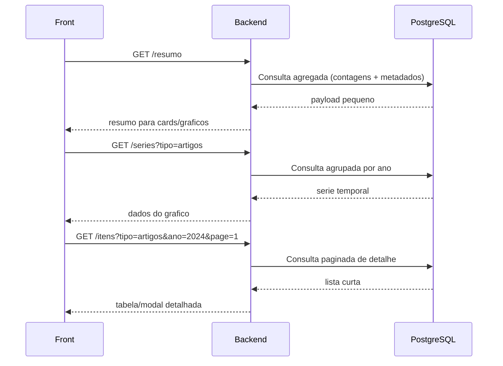
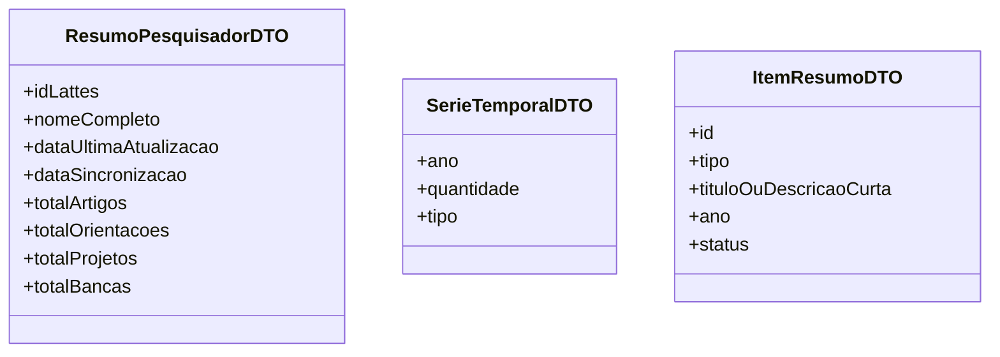

# LattesVision

## Visão Geral do Projeto
Plataforma web para **extração, visualização e análise automatizada de dados de Currículos Lattes** (CNPq).

**Autor:** Renan Alencar Soares  
**Instituição:** Universidade Federal do Ceará – Campus Quixadá  
**Curso:** Engenharia de Software  
**Orientador:** Prof. Dr. Emanuel Ferreira Coutinho  
**Tipo:** Trabalho de Conclusão de Curso (TCC) – 2026

## Problema que Resolve
Coordenadores de Programas de Pós-Graduação (PPGs) precisam transferir manualmente dados do Lattes para a Plataforma Sucupira (CAPES) a cada ciclo de avaliação quadrienal. Esse processo é lento, manual e sujeito a erros. O LattesVision automatiza a coleta, estruturação e visualização desses dados.

## Público-Alvo
- Coordenadores de cursos de pós-graduação
- Secretários acadêmicos
- Gestores de PPGs

## Objetivos do Sistema
1. Extrair dados automaticamente de currículos da Plataforma Lattes via Web Scraping
2. Classificar e organizar produções e métricas acadêmicas conforme indicadores da CAPES
3. Exibir dashboards interativos com indicadores de desempenho dos pesquisadores/programas

## Stack Tecnológica
- **Backend:** Java com Spring Boot
- **Banco de Dados:** PostgreSQL
- **Frontend:** Vue.js com Apache ECharts
- **Web Scraping:** Playwright + Jsoup
- **Fonte de dados:** Plataforma Lattes (CNPq) — currículos em XML/XSD e páginas HTML

## Domínio do Problema (conceitos importantes)
- **Plataforma Lattes:** Base de currículos acadêmicos do CNPq com +9 milhões de registros
- **Currículo Lattes:** Estruturado em XML/XSD com campos como: Identificação, Formação, Produção Bibliográfica, Orientações, Bancas, etc.
- **Plataforma Sucupira:** Sistema oficial da CAPES para avaliação dos PPGs — é para onde os dados do Lattes precisam ir
- **Avaliação Quadrienal CAPES:** Ciclo de 4 anos onde PPGs recebem notas de 1-7 (mínimo 3 para credenciamento)
- **Web Scraping:** Técnica de extração automatizada de dados de páginas web

## Status Atual do Projeto
- TCC em andamento (2026)
- Parte do código já existe
- Fundamentação teórica escrita (Lattes, Sucupira, Web Scraping)
- Metodologia, Resultados e Conclusão ainda a desenvolver

## Convenções e Boas Práticas
- Código em **inglês** (variáveis, métodos, classes)
- Comentários e documentação em **português** (por ser TCC acadêmico)
- Seguir padrões do Spring Boot (camadas: Controller → Service → Repository)
- Usar JPA/Hibernate para persistência com PostgreSQL
- Testes unitários são bem-vindos

## Estrutura Esperada do Projeto (Spring Boot padrão)
```
lattesvision/
├── src/main/java/br/ufc/lattesvision/
│   ├── controller/
│   ├── service/
│   ├── repository/
│   ├── model/
│   ├── dto/
│   └── scraper/
├── src/main/resources/
│   └── application.properties
└── pom.xml
```

## Notas Importantes
- O Lattes **não possui API oficial pública** — a extração depende de Web Scraping ou do arquivo XML exportável
- O formato XSD do Lattes é público: http://lattes.cnpq.br/web/plataforma-lattes/extracao-de-dados
- Respeitar limites de requisições ao Lattes para não ser bloqueado
- O sistema deve alinhar os dados extraídos aos **5 quesitos da avaliação CAPES**: Proposta do Programa, Corpo Docente, Corpo Discente, Produção Intelectual e Inserção Social
## Memoria Tecnica (Atualizado em 2026-04-27)

### Backend status atual
- Stack ativa: Spring Boot + Playwright + Jsoup + PostgreSQL.
- Fluxo implementado e funcional: resolver ID interno -> scraping -> parse -> persistencia.
- Build local validado com sucesso: `mvn test -q`.

### Regras de API ja aplicadas
- Validacao de ID Lattes no controller: aceitar apenas 16 digitos numericos.
- Sincronizacao individual agora e `POST /api/lattes/sincronizar/{id}` (antes era GET).
- Sincronizacao em lote permanece `POST /api/lattes/sincronizar-lote`.
- Erros de validacao retornam HTTP 400.

### Observabilidade
- `ScraperService` migrado de `System.out/err` para logs estruturados com `slf4j`.
- Eventos logados: inicio/fim de lote, processamento por ID, retries, erros e resumo de persistencia.

### Pontos prioritarios para a proxima sessao
1. Adicionar testes unitarios de parser com fixtures HTML reais do Lattes.
2. Padronizar respostas de erro da API (payload de erro com mensagem/codigo).
3. Revisar documentacao OpenAPI para refletir 100% os codigos de resposta.
4. Opcional: mover credenciais do banco para variaveis de ambiente.

## Decisoes de Arquitetura para Dashboard (2026-04-27)

### Objetivo
Para visualizacao de dados no front-end, evitar retornar payload completo por padrao.
Priorizar endpoints agregados e detalhe sob demanda.

### Estrategia
1. `resumo` para cards e visão geral.
2. `series` para graficos (agrupamento por ano/tipo).
3. `itens` paginado para tabelas e modais de detalhe.

### Fluxo proposto
```mermaid
flowchart TD
    A[Front-end Dashboard] --> B[GET /api/dashboard/pesquisadores/{id}/resumo]
    A --> C[GET /api/dashboard/pesquisadores/{id}/series?tipo=artigos|orientacoes|projetos|bancas]
    A --> D[GET /api/dashboard/pesquisadores/{id}/itens?tipo=artigos&ano=2024&page=1&size=20]

    B --> E[(PostgreSQL)]
    C --> E
    D --> E
```

### Sequencia de uso no front


### DTOs sugeridos (visao de contrato)


### Trade-offs
- Pro: payload menor, front mais rapido, melhor UX.
- Contra: mais endpoints e DTOs para manter.

## Alinhamento de Retorno de Dados para Bibliometria (2026-04-29)

### Decisao consolidada
- Evitar retorno do objeto completo de pesquisador por padrao para telas de dashboard.
- Priorizar payloads agregados por metrica/categoria/status.
- Manter retorno de itens individuais apenas em fluxo de drill-down (detalhe sob demanda).

### Motivacao
- A visualizacao geral e individual bibliometrica nao precisa carregar todas as entidades completas em toda requisicao.
- Reduzir tamanho de resposta melhora performance, tempo de carregamento e experiencia do usuario.
- Separar contratos de dashboard dos modelos JPA reduz acoplamento entre front-end e persistencia.

### Contratos de API priorizados
1. `GET /api/dashboard/pesquisadores/{id}/resumo`
- Contagens agregadas e metadados principais.
- Exemplo de metricas: `totalArtigos`, `totalOrientacoes`, `totalOrientacoesConcluidas`, `totalOrientacoesEmAndamento`, `totalProjetos`, `totalBancas`, `dataUltimaAtualizacao`, `dataSincronizacao`.

2. `GET /api/dashboard/pesquisadores/{id}/series?tipo=...`
- Series para graficos (ex.: por ano, por tipo, por status).
- Exemplo: artigos por ano; orientacoes por ano/status; projetos por tipo; bancas por tipo.

3. `GET /api/dashboard/pesquisadores/{id}/itens?filtros...&page=&size=`
- Listas paginadas para detalhe somente quando usuario solicitar.

### Diretriz de implementacao
- Primeiro implementar `resumo` para liberar valor rapido ao front.
- Em seguida implementar `series` para os graficos principais.
- Por ultimo implementar `itens` paginado para detalhamento.

### Nota sobre ScriptLattes
- Utilizar ScriptLattes como etapa de enriquecimento/classificacao no pipeline de sincronizacao (offline ou batch), nao como dependencia em tempo de resposta do dashboard.

## Modelagem do TCC (Atualizado em 2026-09-01)

### Diagramas ja definidos
- O capitulo/seção `Modelagem do sistema` deve possuir subseções próprias para cada diagrama, evitando apresentar uma figura sem contextualização.
- **Diagrama de Casos de Uso:** já elaborado. Apresenta as funcionalidades do LattesVision sob a perspectiva do gestor de PPG, como consulta de pesquisadores, visualização de indicadores, filtros e análise individual ou de grupos.
- **Diagrama de Sequência:** já definido em nível alto para o fluxo de obtenção e visualização do dashboard individual. Participantes: Gestor do PPG, Interface Web, LattesVision, Base de Dados Local e Plataforma Lattes. O fragmento alternativo diferencia o uso de dados já sincronizados da obtenção, processamento, classificação e persistência de um currículo ainda ausente.

### Diretriz de redação
- O texto do TCC deve refletir somente funcionalidades implementadas. A exportação de dados ainda não deve ser apresentada como caso de uso implementado, pois o botão atual da interface não possui comportamento de exportação.
- Próximos diagramas serão definidos em sessão futura conforme a evolução do sistema.

## Arquitetura de Chamadas: Visao de Grupo e Individual (2026-04-29)

### Cenario funcional
- O sistema deve aceitar sincronizacao de um ou mais IDs Lattes.
- O usuario deve conseguir:
  - visualizar indicadores consolidados de um grupo de pesquisadores/professores;
  - abrir o detalhe individual ao selecionar um pesquisador especifico.

### Separacao de responsabilidades
- Sincronizacao: endpoints de ingestao/coleta e persistencia.
- Consulta de dashboard: endpoints de leitura agregada (sem scraping em tempo real).

### Endpoints de sincronizacao
1. `POST /api/lattes/sincronizar/{id}`
2. `POST /api/lattes/sincronizar-lote`

### Estrategia para grupos persistidos
- Criar conceito de grupo para reuso e analise recorrente.
- Endpoint sugerido para cadastro:
  - `POST /api/grupos`
  - Exemplo de payload: `{ "nome": "Docentes PPG ES", "idsLattes": ["..."] }`
  - Retorno esperado: `grupoId`.

### Endpoints de dashboard: visao de grupo
1. `GET /api/dashboard/grupos/{grupoId}/resumo`
- Cards consolidados do grupo.
- Ex.: `totalPesquisadores`, `totalArtigos`, `totalOrientacoesConcluidas`, `totalProjetos`, `totalBancas`.
- Incluir metricas derivadas, quando aplicavel: `mediaArtigosPorPesquisador`, `percentualOrientacoesConcluidas`.

2. `GET /api/dashboard/grupos/{grupoId}/series?tipo=...&agruparPor=...`
- Series agregadas para graficos (somatorio dos membros).

3. `GET /api/dashboard/grupos/{grupoId}/ranking?metrica=...&ordem=desc&page=0&size=20`
- Ranking paginado por metrica (artigos, orientacoes, etc.).

4. `GET /api/dashboard/grupos/{grupoId}/itens?tipo=...&filtros...&page=0&size=20`
- Drill-down paginado de itens do grupo.

### Endpoints de dashboard: visao individual
1. `GET /api/dashboard/pesquisadores/{id}/resumo`
2. `GET /api/dashboard/pesquisadores/{id}/series?tipo=...&agruparPor=...`
3. `GET /api/dashboard/pesquisadores/{id}/itens?tipo=...&filtros...&page=0&size=20`

### Padronizacao de contrato
- Padronizar estrutura de resposta entre escopos (`GROUP` e `RESEARCHER`) para simplificar front-end.
- Exemplo conceitual: `scope`, `refId`, `cards`, `filtrosAplicados`, `dados`.

### Filtros transversais recomendados
- `periodoInicio`, `periodoFim`, `tipo`, `status`, `ano`.

### Regras nao funcionais recomendadas
- Nunca retornar entidade JPA completa nos endpoints de dashboard.
- Usar DTOs agregados e DTOs de detalhe paginado.
- Paginacao obrigatoria em `ranking` e `itens`.
- Aplicar cache curto nos GETs de dashboard (30-120s).

### Opcao de grupo ad-hoc (sem persistencia)
- Endpoint opcional para analise pontual por lista de IDs:
  - `POST /api/dashboard/grupo-adhoc/resumo`
- Observacao: para uso recorrente, preferir grupos persistidos (`grupoId`) por rastreabilidade e desempenho.

## Proxima Feature Planejada: Producao Tecnica (2026-04-29)

### Contexto da decisao
- Foi validado no repositorio `scriptLattes-main/` que a producao tecnica e tratada de forma explicita em categorias separadas.
- Objetivo no LattesVision: incorporar esse bloco ao backend para ampliar cobertura bibliometrica/CAPES alem de artigos, orientacoes, projetos e bancas.

### Evidencias no scriptLattes (referencia funcional)
Categorias identificadas no `scriptLattes-main/scriptLattes/producoesTecnicas/`:
- `softwareComPatente.py` (programa de computador com registro)
- `softwareSemPatente.py` (programa de computador sem registro)
- `produtoTecnologico.py`
- `processoOuTecnica.py`
- `trabalhoTecnico.py`
- `outroTipoDeProducaoTecnica.py`
- `entrevista.py`

Complementarmente, o `README.md` do scriptLattes destaca producao tecnica e exportacao JSON individual abrangente.

### Diretriz de modelagem recomendada no backend (fase inicial)
- Criar entidade unica `ProducaoTecnica` relacionada a `Pesquisador`.
- Adotar `categoria` (enum) para representar os tipos tecnicos sem fragmentar em varias tabelas no primeiro momento.

Categorias iniciais sugeridas:
- `SOFTWARE_COM_REGISTRO`
- `SOFTWARE_SEM_REGISTRO`
- `PRODUTO_TECNOLOGICO`
- `PROCESSO_OU_TECNICA`
- `TRABALHO_TECNICO`
- `OUTRA`

Campos minimos sugeridos para MVP:
- `id`
- `categoria`
- `titulo`
- `autoresTexto`
- `ano`
- `natureza` (quando aplicavel, ex.: processo/tecnica)
- `descricaoBruta` (texto original extraido para rastreabilidade)
- `pesquisador` (ManyToOne)

### Metricas iniciais (entrega de valor rapida)
1. Total de producoes tecnicas por pesquisador.
2. Total por categoria tecnica.
3. Serie temporal por ano (producao tecnica).
4. Ranking por pesquisador em contexto de grupo (quantidade de producao tecnica).

### Estrategia de implementacao sugerida (proxima sessao)
1. Model + migration (`ProducaoTecnica` + enum categoria).
2. Parser de producao tecnica no scraping atual.
3. Persistencia vinculada ao `Pesquisador`.
4. Inclusao no endpoint `resumo` (individual e grupo).
5. Inclusao no endpoint `series` por categoria/ano.
6. Opcional: endpoint `itens` paginado para drill-down de producao tecnica.

### Trade-off assumido
- Opcao por entidade unica com enum acelera entrega e simplifica consultas de dashboard.
- Caso a complexidade cresca (muitos campos especificos por categoria), evoluir para subtipos/tabelas especializadas em fase posterior.

## Memoria Tecnica (Atualizado em 2026-05-06)

### Testes unitarios de parsers
- Foram adicionados testes unitarios puros para os parsers atuais, sem subir Spring nem banco:
  - `ArtigoParserTest`
  - `OrientacaoParserTest`
  - `ProjetoParserTest`
  - `BancaParserTest`
  - `ProducaoTecnicaParserTest`
- Objetivo: fixar comportamento de extracao a partir de HTML minimo representativo do Lattes.
- Ajustes feitos durante os testes:
  - `OrientacaoParser` passou a normalizar texto para busca, reduzindo fragilidade com acentos/sem acentos.
  - `BancaParser` tambem passou a normalizar texto para busca e marcador de "Participacao em banca de".
- Validacao local: `mvn test -q` executado com sucesso.

### Producao Tecnica implementada no backend
- Feature implementada no escopo enxuto decidido para o LattesVision.
- Nao foi replicado o detalhamento completo do `scriptLattes`; a decisao foi manter uma visao geral adequada para dashboard/bibliometria.
- Nova modelagem:
  - `CategoriaProducaoTecnica`
  - `ProducaoTecnica`
- Categorias adotadas:
  - `SOFTWARE_COM_REGISTRO`
  - `SOFTWARE_SEM_REGISTRO`
  - `PRODUTO_TECNOLOGICO`
  - `PROCESSO_OU_TECNICA`
  - `TRABALHO_TECNICO`
  - `OUTRA`
- Entrevistas, mesas redondas, programas e comentarios na midia sao mapeados para `OUTRA`, por serem considerados menos relevantes para o foco atual do dashboard.
- Campos persistidos em `ProducaoTecnica`:
  - `id`
  - `categoria`
  - `titulo`
  - `autoresTexto`
  - `ano`
  - `natureza`
  - `descricaoBruta`
  - `pesquisador`
- `descricaoBruta` foi mantida para rastreabilidade e eventual reprocessamento futuro.
- `Pesquisador` agora possui relacionamento `OneToMany` com `producoesTecnicas`, usando cascade e orphan removal como nas demais colecoes.
- `ScraperService` passou a chamar `ProducaoTecnicaParser.parse(doc)` e persistir a colecao junto com artigos, orientacoes, projetos e bancas.

### Referencia usada do scriptLattes
- Codigo consultado em `scriptLattes-main/`.
- O scriptLattes separa producao tecnica em varias classes:
  - `softwareComPatente.py`
  - `softwareSemPatente.py`
  - `produtoTecnologico.py`
  - `processoOuTecnica.py`
  - `trabalhoTecnico.py`
  - `outroTipoDeProducaoTecnica.py`
  - `entrevista.py`
- Conclusao da analise:
  - A regra de extracao e muito parecida entre categorias.
  - Para o LattesVision, entidade unica com enum e suficiente neste momento.
  - Campos especificos como finalidade, instituicao, veiculo etc. ficaram fora do MVP.

### Validacao manual via Swagger
- Endpoint usado:
  - `POST /api/lattes/sincronizar/{id}`
- Como `spring.jpa.hibernate.ddl-auto=update` esta ativo, a tabela `producoes_tecnicas` foi criada/atualizada automaticamente pelo Hibernate.
- Teste 1 retornou producoes tecnicas em `SOFTWARE_SEM_REGISTRO`, extraindo corretamente:
  - autores
  - titulo
  - ano
  - descricao bruta
- Teste 2 retornou uma lista maior com:
  - `SOFTWARE_SEM_REGISTRO`
  - `TRABALHO_TECNICO`
- Caso validado: titulo contendo referencia como `2015.2` e ano final `2016`; parser capturou corretamente o ultimo ano como ano da producao.

### Pontos pendentes / proximos passos
1. Criar endpoints de dashboard agregados para pesquisador:
   - `GET /api/dashboard/pesquisadores/{id}/resumo`
   - incluir `totalProducoesTecnicas`.
2. Criar series de producao tecnica:
   - por ano
   - por categoria
3. Criar itens paginados para drill-down:
   - filtro por `tipo=producoesTecnicas`
   - filtro por categoria e ano.
4. Avaliar se o endpoint bruto `GET /api/lattes/{id}` deve continuar retornando entidade completa ou se deve ser tratado como endpoint administrativo/debug.
5. Opcional: adicionar repository especifico para `ProducaoTecnica` quando forem implementadas consultas agregadas.
6. Opcional: mover credenciais do banco para variaveis de ambiente.

## Memoria Tecnica (Atualizado em 2026-05-10)

### Dashboard individual - resumo agregado e series temporais
- Foi consolidado o modulo de dashboard com foco em indicadores bibliometricos.
- Endpoint de resumo individual: `GET /api/dashboard/pesquisadores/{id}/resumo` (validado).
  - Campos: `idLattes`, `nomeCompleto`, `dataUltimaAtualizacao`, `dataSincronizacao`, `totalArtigos`, `totalOrientacoes`, `totalOrientacoesConcluidas`, `totalOrientacoesEmAndamento`, `totalProjetos`, `totalBancas`, `totalProducoesTecnicas` e `totalTrabalhosEventos`.
- Novo endpoint de series temporais: `GET /api/dashboard/pesquisadores/{id}/series?tipo=...`
  - Suporta: `artigos`, `orientacoes`, `projetos`, `bancas`, `producoes_tecnicas` e `trabalhos_eventos`.
  - Retorna dados agrupados por ano e ordenados cronologicamente.

### Implementacao de Trabalhos em Eventos
- Nova entidade `TrabalhoEvento` vinculada ao `Pesquisador`.
- Parser especializado `TrabalhoEventoParser`:
  - Focado exclusivamente em **Trabalhos completos publicados em anais de congressos**.
  - Ignora resumos simples e expandidos para alinhar a contagem com o resumo oficial do Lattes.
  - Implementada "trava de segurança" para interromper a captura ao encontrar seções não relacionadas (evita vazamento de dados de bancas/orientações).
- Validacao real: Contagem de 81 trabalhos completos para o pesquisador de teste batendo 100% com o portal Lattes.

### Referencias e Inspiracao
- Analise do `scriptLattes-main` (Python) concluida.
- Decisao arquitetural: Manter a estrutura de dados rica no banco (com tipos e categorias), mas expor endpoints agregados para o frontend manter alta performance.

### Pontos pendentes / proximos passos
1. Implementar dashboard de **Grupos** (visao consolidada de varios pesquisadores).
2. Criar endpoint de **Itens Paginados** para drill-down (detalhe por ano/tipo).
3. Evoluir para indicadores de producao bibliografica de Livros e Capitulos.

## Memoria Tecnica (Atualizado em 2026-06-25)

### Frontend iniciado com Vue 3 + Vite + TypeScript
- Foi criado o projeto `frontend/` com Vue 3, Vite e TypeScript.
- Dependencias adicionadas:
  - `vue-router`
  - `pinia`
  - `axios`
  - `echarts`
- Estrutura inicial implementada:
  - `src/router`
  - `src/views`
  - `src/components/dashboard`
  - `src/services`
  - `src/stores`
  - `src/types`

### Base funcional inicial do frontend
- O template padrao do Vite foi removido e substituido por uma base de aplicacao real.
- Foram criadas:
  - tela inicial para entrada do ID Lattes;
  - tela de dashboard individual;
  - store Pinia para resumo e series temporais;
  - cliente HTTP com `axios`;
  - componente de grafico com `ECharts`.
- O `vite.config.ts` foi configurado com proxy:
  - `/api -> http://localhost:8080`

### Ajuste de regra de negocio para consulta do dashboard
- Foi identificado um problema de UX no fluxo inicial:
  - o frontend chamava `GET /api/dashboard/pesquisadores/{id}/resumo`;
  - se o pesquisador nao existisse localmente, o backend retornava `404`;
  - isso exigia que o usuario soubesse previamente se o ID ja estava sincronizado.
- Decisao tomada:
  - a regra de "consultar se existir, sincronizar se nao existir" deve ficar no backend, nao no frontend.

### Novo endpoint de entrada unico para dashboard individual
- Foi criado o endpoint:
  - `POST /api/dashboard/pesquisadores/{id}/carregar`
- Regra implementada:
  - se o pesquisador ja existe no banco, retornar o resumo agregado imediatamente;
  - se nao existe, executar `ScraperService.sincronizarPesquisador(id)` e depois retornar o resumo agregado.
- Implementacao realizada em:
  - `DashboardController`
  - `DashboardService`
- `DashboardService` passou a depender de `ScraperService` para executar o fallback de sincronizacao quando necessario.

### Testes adicionados no backend
- Foi criado teste unitario para travar o comportamento do novo fluxo:
  - `DashboardServiceTest`
- Casos cobertos:
  - nao sincronizar quando o pesquisador ja existe localmente;
  - sincronizar quando o pesquisador nao existe no banco.
- Validacao executada com sucesso:
  - `mvn test -q`

### Integracao do frontend com o novo endpoint
- O frontend foi alterado para usar `POST /api/dashboard/pesquisadores/{id}/carregar` como porta de entrada do dashboard individual.
- Fluxo atual do frontend:
  1. usuario informa o ID Lattes;
  2. frontend chama `POST /carregar`;
  3. backend decide entre retornar do banco ou sincronizar;
  4. frontend recebe o resumo;
  5. frontend chama `GET /api/dashboard/pesquisadores/{id}/series?tipo=...`.

### Observacoes importantes para a proxima sessao
- A interface atual do frontend foi criada como base funcional para integracao com backend.
- O proprio usuario sinalizou que a direcao visual atual esta com "cara de IA" e deve ser redesenhada depois.
- Portanto, o estado atual do frontend deve ser tratado como:
  - base tecnica valida;
  - nao como direcao visual final do produto.

### Proximos passos recomendados
1. Redesenhar a linguagem visual do frontend com uma direcao menos generica e mais autoral.
2. Melhorar feedback de carregamento no dashboard para deixar explicito quando o backend esta sincronizando um pesquisador novo.
3. Evoluir para dashboard de grupos, ranking e drill-down paginado quando a camada de leitura agregada crescer.

## Memoria Tecnica (Atualizado em 2026-07-01)

### Redesenho visual do frontend
- A tela inicial foi redesenhada para uma estetica mais institucional/sistema academico, evitando visual generico de IA.
- Diretrizes aplicadas:
  - fundo simples e claro;
  - menos cards decorativos;
  - bordas discretas;
  - tipografia global inspirada na Microsoft:
    - `"Segoe UI", SegoeUI, "Helvetica Neue", Helvetica, Arial, sans-serif`;
  - paleta principal baseada em azul institucional.
- A logo do LattesVision foi adicionada no header a partir de:
  - `frontend/src/assets/Lattes_VISION__1_-removebg-preview.png`
- Header atual:
  - logo a esquerda;
  - links `Inicio` e `Sobre` a direita, ainda sem navegacao real.
- A home passou a usar o titulo:
  - `Analise de Curriculos Lattes`
- O botao principal passou a ser:
  - `Analisar`
- O campo de entrada foi alterado para:
  - `ID(s) Lattes`

### Feedback de carregamento antes do dashboard
- Foi implementado modal de espera na home antes de redirecionar para o dashboard.
- Fluxo individual atual:
  1. usuario informa um ID Lattes;
  2. clica em `Analisar`;
  3. a home exibe modal `Consultando curriculo`;
  4. o frontend chama `POST /api/dashboard/pesquisadores/{id}/carregar`;
  5. somente apos receber o resumo, redireciona para `/pesquisadores/{id}`.
- A store Pinia passou a registrar `currentResumoId`, evitando reaproveitar dados de pesquisador antigo quando a rota muda.
- `loadResumo` limpa resumo e serie antigos antes de iniciar nova consulta.

### Entrada com multiplos IDs Lattes
- A home agora aceita:
  - um unico ID Lattes;
  - multiplos IDs separados por virgula, espaco, ponto e virgula ou quebra de linha.
- Validacao no frontend:
  - cada ID deve possuir exatamente 16 digitos numericos.
- Fluxo:
  - 1 ID: usa dashboard individual;
  - 2+ IDs: usa dashboard de grupo ad-hoc.

### Dashboard de grupo ad-hoc implementado
- Foi criado suporte real a analise de grupo, sem persistir um cadastro de grupo ainda.
- Novo endpoint backend:
  - `POST /api/dashboard/grupo-adhoc/carregar`
- Payload:
```json
{
  "idsLattes": ["9359546788802277", "6255476538629622"]
}
```
- Regra de negocio:
  - para cada ID informado:
    - se pesquisador ja existe no banco, usa o registro local;
    - se nao existe, executa `ScraperService.sincronizarPesquisador(id)`;
  - depois monta resumo agregado do grupo.
- Isso evita scraper desnecessario para curriculos ja salvos e reduz risco de bloqueio no Lattes.
- DTOs adicionados:
  - `GrupoAdhocRequestDTO`
  - `ResumoGrupoDTO`
- Metodo principal no service:
  - `DashboardService.carregarResumoGrupoAdhoc(List<String> idsLattes)`
- Teste unitario adicionado em `DashboardServiceTest` para garantir que pesquisadores ja existentes nao sao sincronizados novamente.

### Tela de dashboard de grupo no frontend
- Nova rota:
  - `/grupos/adhoc?ids=...`
- Nova view:
  - `frontend/src/views/GrupoAdhocView.vue`
- A tela exibe:
  - titulo `Analise de grupo`;
  - quantidade de curriculos analisados;
  - botao `Exportar Dados` sem acao por enquanto;
  - cards agregados:
    - pesquisadores;
    - artigos;
    - orientacoes;
    - projetos;
    - bancas;
    - producoes tecnicas;
    - trabalhos em eventos;
  - bloco de filtros em preparacao;
  - lista de pesquisadores analisados com acao `Ver individual`.
- A store `dashboard.ts` passou a manter:
  - `resumoGrupo`;
  - `grupoIds`;
  - `serieGrupo`.

### Grafico de evolucao anual do grupo
- Foi criado endpoint backend para series anuais agregadas:
  - `POST /api/dashboard/grupo-adhoc/series`
- DTO adicionado:
  - `SerieGrupoDTO`
- O endpoint agrega por ano os tipos ja existentes no backend:
  - artigos;
  - trabalhos em eventos;
  - producoes tecnicas;
  - orientacoes;
  - projetos;
  - bancas.
- No frontend foi criado:
  - `frontend/src/components/dashboard/GrupoStackedLineChart.vue`
- O grafico usa Apache ECharts e aparece abaixo dos filtros na tela de grupo.
- Titulo da secao:
  - `Producao por ano`
- Subtitulo:
  - `Evolucao anual das producoes academicas por tipo.`
- O grafico foi ajustado para linhas sem preenchimento/area, pois o preenchimento estava visualmente estranho.
- Observacao importante:
  - livros e capitulos ainda nao existem no backend; quando forem implementados, devem entrar no `SerieGrupoDTO`, no agregador do `DashboardService` e no grafico.

### Ajustes no dashboard individual
- O topo do dashboard individual foi simplificado:
  - removeu o bloco `Serie exibida`;
  - removeu texto generico sobre backend;
  - manteve apenas `ID Lattes {id}`.
- Adicionado botao `Exportar Dados`, ainda sem acao.
- Foi reservado bloco de filtros abaixo dos cards de resumo:
  - periodo inicial;
  - periodo final;
  - botao `Aplicar filtros` desativado.
- A fonte do ECharts foi padronizada explicitamente para a mesma stack global do projeto, pois canvas nao herda CSS de forma confiavel.

### Validacoes executadas
- Backend:
  - `mvn test -q` executado com sucesso.
- Frontend:
  - `npm run build` executado com sucesso.
- Avisos conhecidos:
  - Vite alerta bundle grande por causa do ECharts;
  - Maven/Mockito alerta sobre ByteBuddy agent dinamico, mas os testes passam.

### Proximos passos recomendados
1. Criar endpoint de itens paginados para drill-down.
   - individual e grupo;
   - por ano/tipo/categoria;
   - objetivo: permitir auditar quais itens compoem os totais e graficos.
2. Implementar filtros reais no backend e frontend.
   - `periodoInicio`
   - `periodoFim`
   - tipo de producao
   - pesquisador
3. Evoluir producao bibliografica com livros e capitulos.
   - modelagem;
   - parser;
   - persistencia;
   - inclusao nos resumos e series.
4. Avaliar persistencia de grupos nomeados.
   - `POST /api/grupos`
   - reuso posterior por `grupoId`.
5. Refinar visual dos dashboards.
   - hierarquia de graficos;
   - densidade dos cards;
   - estado vazio;
   - responsividade.

## Memoria Tecnica (Atualizado em 2026-07-02)

### Ranking de pesquisadores no dashboard de grupo
- Foi implementado o ranking por pesquisador na tela de grupo ad-hoc.
- Novo endpoint backend:
  - `POST /api/dashboard/grupo-adhoc/ranking?metrica=...`
- Payload:
```json
{
  "idsLattes": ["9359546788802277", "6255476538629622"]
}
```
- Metricas suportadas:
  - `total`
  - `artigos`
  - `orientacoes`
  - `projetos`
  - `bancas`
  - `producoes_tecnicas`
  - `trabalhos_eventos`
- Novo DTO:
  - `RankingPesquisadorDTO`
- Regra do backend:
  - reaproveita o mesmo fluxo de grupo ad-hoc;
  - usa pesquisador local quando ja existe;
  - sincroniza apenas IDs ausentes;
  - calcula a quantidade por pesquisador;
  - ordena de forma decrescente pela quantidade.
- Teste unitario adicionado em `DashboardServiceTest` para validar ordenacao do ranking por metrica.

### Ranking no frontend
- Novo componente:
  - `frontend/src/components/dashboard/GrupoRankingChart.vue`
- O grafico usa Apache ECharts com barras horizontais, mais adequado para nomes longos de pesquisadores.
- A tela `GrupoAdhocView.vue` recebeu a secao:
  - `Ranking de pesquisadores`
- Foi adicionado seletor de metrica no painel:
  - Total geral
  - Artigos
  - Trabalhos em eventos
  - Producoes tecnicas
  - Orientacoes
  - Projetos
  - Bancas
- A store `dashboard.ts` passou a manter:
  - `rankingGrupo`
  - `rankingMetrica`
  - `loadingRanking`
  - `errorRanking`
- O service `dashboard.service.ts` recebeu a chamada:
  - `fetchRankingGrupoAdhoc(idsLattes, metrica)`

### Ajuste de suavidade nos graficos
- Foi identificado que o ranking "piscava" ao trocar metrica porque a store limpava `rankingGrupo` antes da nova resposta.
- Ajuste aplicado:
  - manter o grafico antigo enquanto a nova metrica carrega;
  - atualizar os dados somente quando a resposta chega;
  - mostrar loading apenas na carga inicial, quando ainda nao ha dados.
- O mesmo padrao foi aplicado tambem:
  - no grafico de series temporais do dashboard individual;
  - no grafico de evolucao anual do grupo.
- Resultado: trocas de metrica/tipo ficam mais suaves, sem desmontar e remontar o grafico quando ja existe dado em tela.

### Validacoes executadas
- Backend:
  - `.\mvnw.cmd test -q` executado com sucesso em `backend/`.
- Frontend:
  - `npm run build` executado com sucesso em `frontend/`.
- Observacoes:
  - `mvn test -q` usando Maven global apresentou problema de `testCompile` nao enxergando classes principais;
  - o wrapper `.\mvnw.cmd test -q` funciona corretamente e deve ser preferido neste projeto;
  - Vite segue alertando bundle grande por causa do ECharts, mas o build passa.

### Proximo passo recomendado
- Priorizar drill-down paginado antes de novos graficos.
- Motivacao:
  - os dashboards ja mostram totais, evolucao anual e ranking;
  - falta permitir ao usuario auditar quais itens compoem cada numero.
- Contrato sugerido:
  - endpoint de itens paginados para individual e grupo;
  - filtros por tipo, ano, categoria e pesquisador;
  - tabela no frontend para listar titulo/descricao, pesquisador, ano e status/categoria quando aplicavel.

## Memoria Tecnica (Atualizado em 2026-07-04)

### Dashboard individual: graficos empilhados
- A tela individual `PesquisadorView.vue` deixou de usar seletor unico de serie temporal.
- Os graficos agora aparecem um abaixo do outro, na seguinte ordem:
  - Artigos publicados em periodicos;
  - Trabalhos em eventos;
  - Orientacoes;
  - Projetos;
  - Participacoes em bancas;
  - Producoes tecnicas.
- O frontend carrega as series em paralelo a partir dos endpoints existentes, exceto para bancas e orientacoes, que passaram a ter agregacoes especificas.
- A store `dashboard.ts` passou a manter:
  - `seriesByTipo`;
  - `bancasPorTipo`;
  - `orientacoesPorStatusAno`.

### Fonte do sistema
- A fonte global do frontend foi alterada para priorizar `Inter`:
  - `Inter, "Segoe UI", SegoeUI, "Helvetica Neue", Helvetica, Arial, sans-serif`
- O CSS importa Inter via Google Fonts em `frontend/src/style.css`.
- Os componentes ECharts tambem foram ajustados para usar a mesma stack, pois canvas nao herda a fonte global de forma confiavel.
- Componentes ajustados:
  - `SerieChart.vue`;
  - `GrupoStackedLineChart.vue`;
  - `GrupoRankingChart.vue`;
  - `CategoryPieChart.vue`;
  - `OrientacaoStatusChart.vue`.

### Participacoes em bancas por tipo
- O grafico de bancas deixou de ser serie temporal por ano e passou a ser donut por tipo de banca.
- Novo DTO backend:
  - `CategoriaQuantidadeDTO`
- Novo endpoint:
  - `GET /api/dashboard/pesquisadores/{id}/bancas/tipos`
- Regra de agregacao:
  - agrupar por `Banca.tipo`;
  - tipo vazio vira `Outra`;
  - `TCC` e exibido no frontend como `Graduacao`/`Graduação`.
- Novo componente frontend:
  - `frontend/src/components/dashboard/CategoryPieChart.vue`
- Ajustes visuais do donut:
  - legenda posicionada proxima ao grafico como grupo visual;
  - labels externos removidos para nao invadir a area da legenda;
  - leitura de categoria/quantidade fica por legenda e tooltip;
  - paleta categórica variada, evitando tudo azul.

### Orientacoes por status
- O grafico de orientacoes deixou de mostrar apenas total anual.
- Agora cada ano possui duas barras lado a lado:
  - `Concluidas`;
  - `Em andamento`.
- Cores definidas:
  - Concluidas: `#639922`;
  - Em andamento: `#C0DD97`.
- Novo DTO backend:
  - `SerieOrientacaoStatusDTO`
- Novo endpoint:
  - `GET /api/dashboard/pesquisadores/{id}/orientacoes/status-series`
- Regra de agregacao:
  - agrupar por ano;
  - contar separadamente status `CONCLUIDA` e `EM_ANDAMENTO`.
- Novo componente frontend:
  - `frontend/src/components/dashboard/OrientacaoStatusChart.vue`
- O grafico usa barras agrupadas, tooltip por eixo e legenda inferior.

### Testes e validacoes executadas
- Backend:
  - `mvn test -q` executado com sucesso em `backend/`.
  - Testes adicionados em `DashboardServiceTest` para:
    - bancas agrupadas por tipo;
    - orientacoes agrupadas por ano e status.
- Frontend:
  - `npm run build` executado com sucesso em `frontend/`.
- Avisos conhecidos:
  - Vite segue alertando bundle grande por causa do ECharts;
  - Maven/Mockito segue emitindo avisos de ByteBuddy/dynamic agent, mas a suite passa.

### Observacoes de produto
- Para dashboard individual, a prioridade visual atual e leitura rapida de perfil academico.
- Artigos publicados em periodicos permanecem como primeiro grafico por relevancia para avaliacao academica/PPG.
- Donut funciona melhor para distribuicao categorica, nao para evolucao temporal.
- Orientacoes precisam preservar status, pois total agregado esconde diferenca entre producao concluida e atividade em andamento.
- Proximo passo ainda recomendado:
  - implementar drill-down paginado para auditar os itens por grafico, ano, tipo, status e categoria.

## Investigacao e Direcao Arquitetural para Qualis (2026-07-16)

### Objetivo funcional
- Enriquecer a analise de artigos em periodicos com uma dimensao qualitativa, alem das contagens atuais.
- Permitir indicadores individuais e de grupo por estrato Qualis, preservando rastreabilidade da fonte e do ciclo avaliativo.

### Investigacao do scriptLattes
- O `scriptLattes-main/` declara suporte a associacoes Qualis para revistas e congressos.
- A documentacao historica orienta fornecer listas Qualis em CSV, separadas por tabulacao.
- A versao presente no repositorio extrai ISSN e ainda possui campos/saidas relacionados a Qualis, mas nao foi localizada uma rotina operacional completa que carregue a tabela e atribua os estratos aos artigos.
- A abordagem historica tambem contempla correspondencia por nome exato ou similar, o que pode produzir falsos positivos quando comparado ao uso de um identificador estruturado.

### Investigacao do QLattes
- Repositorio de referencia: `https://github.com/nabormendonca/qlattes` (licenca MIT).
- O QLattes extrai o ISSN diretamente do atributo `cvuri` presente no HTML de cada artigo do Lattes.
- A classificacao e feita localmente, sem consultar servicos externos durante a abertura do curriculo.
- Estrategia de correspondencia:
  - busca por ISSN principal;
  - tentativa por ISSN alternativo (ex.: versao impressa/eletronica);
  - resultado `Nao classificado` quando nenhuma fonte possui o ISSN.
- O QLattes evita classificar congressos/eventos automaticamente porque eles nao possuem identificador universal equivalente ao ISSN.
- A versao atual analisada ainda distribui principalmente a base Qualis CAPES 2017-2020, portanto nao deve ser usada como fonte oficial vigente para o ciclo 2021-2024.

### Situacao atual do LattesVision
- A entidade `Artigo` armazena somente `id`, `citacaoCompleta`, `ano` e `pesquisador`.
- O `ArtigoParser` usa o texto visivel do elemento `div.artigo-completo` e atualmente descarta os dados estruturados existentes no `cvuri`.
- Antes de classificar artigos, o parser deve passar a extrair pelo menos:
  - `titulo`;
  - `periodico`;
  - `issn`;
  - `doi`;
  - `ano`;
  - `citacaoCompleta`.

### Decisao sobre fonte de dados
- Nao incorporar o QLattes como dependencia de execucao do LattesVision.
- Nao copiar a base 2017-2020 do QLattes como fonte principal da feature.
- Usar o QLattes apenas como referencia de arquitetura, extracao do `cvuri` e tratamento de ISSN alternativo.
- Obter a planilha oficial completa do Qualis Periodicos 2021-2024 disponibilizada pela CAPES/Sucupira.
- Evitar baixar apenas categorias/areas selecionadas: a base completa melhora cobertura e o Qualis dos ciclos recentes adota classificacao unica por periodico, com registro da area-mae.
- Manter os dados Qualis localmente no PostgreSQL. O dashboard nao deve depender de chamadas em tempo real a CAPES, Scopus ou outros servicos.

### Modelagem recomendada
- Evoluir `Artigo` com os campos estruturados `titulo`, `periodico`, `issn` e `doi`.
- Criar entidade/tabela `ClassificacaoQualis` com, no minimo:
  - `id`;
  - `issnNormalizado`;
  - `issnFormatado`;
  - `tituloPeriodico`;
  - `estrato`;
  - `cicloInicio`;
  - `cicloFim`;
  - `areaMae`;
  - `fonte`;
  - `dataImportacao`.
- Aplicar unicidade por `issnNormalizado + cicloInicio + cicloFim`.
- Normalizar ISSN removendo hifen, espacos e diferencas de caixa antes da comparacao.
- Manter associacao opcional de `Artigo` para `ClassificacaoQualis`, evitando copiar o estrato como texto em todos os artigos.
- Prever estados distintos para:
  - artigo classificado;
  - artigo sem ISSN;
  - ISSN nao encontrado na base;
  - artigo fora do ciclo disponivel.

### Fluxo recomendado
1. Importar a planilha oficial para `classificacoes_qualis` por um processo offline/controlado.
2. Extrair e persistir o ISSN durante o scraping do artigo.
3. Um `QualisService` resolve a classificacao exata pelo ISSN e ciclo correspondente ao ano do artigo.
4. Persistir a associacao encontrada para consultas eficientes e rastreaveis.
5. Disponibilizar rotina de reclassificacao em lote para artigos existentes ou apos nova importacao/correcao da base.
6. Nunca apresentar classificacao inferida por nome ou percentil externo como se fosse Qualis oficial. Eventual estimativa futura deve possuir rotulo e fonte diferentes.

### Estrategia de desempenho
- Uma base com aproximadamente 31 mil periodicos e pequena para PostgreSQL; o gargalo esperado continua sendo o scraping do Lattes, nao a consulta Qualis.
- Criar indice unico composto em `issnNormalizado + cicloInicio + cicloFim` para evitar varredura completa da tabela.
- Normalizar o ISSN uma unica vez na importacao da base e uma vez na extracao do artigo.
- Evitar o problema de N consultas para N artigos:
  - coletar os ISSNs distintos dos artigos sincronizados;
  - consultar todas as classificacoes necessarias em uma unica operacao `WHERE issn_normalizado IN (...)`;
  - montar um mapa em memoria por ISSN;
  - associar e persistir os artigos em lote.
- Importar a planilha em lotes controlados (ex.: 500 ou 1.000 registros), com relatorio de inseridos, atualizados, duplicados e invalidos.
- Nao carregar toda a base em cache nem adicionar Caffeine inicialmente. Consultas indexadas devem ser suficientes; cache so deve ser introduzido apos medicao demonstrar necessidade.
- Evitar busca textual por nome do periodico no caminho automatico, pois e mais custosa e menos confiavel que correspondencia exata por ISSN.
- Para consultas de dashboard, preferir agregacoes executadas no banco e DTOs, sem carregar entidades completas ou toda a tabela Qualis em memoria.

### Estrategia de importacao
- A migration deve criar apenas a estrutura, restricoes e indices; nao incluir dezenas de milhares de `INSERTs` em uma migration SQL gigante.
- Preservar o arquivo oficial original como evidencia da fonte e do ciclo importado.
- Implementar importador proprio para XLSX/CSV, possivelmente com Apache POI para XLSX.
- O importador deve validar formato e digito verificador do ISSN, normalizar valores e tratar duplicidades antes de persistir.
- A importacao/atualizacao da base Qualis nao deve ocorrer automaticamente a cada inicializacao da aplicacao.

### Escopo inicial recomendado
- Iniciar exclusivamente com artigos publicados entre 2021 e 2024 e com a classificacao oficial Qualis 2021-2024.
- Artigos de outros periodos permanecem fora da cobertura ate que as bases historicas correspondentes sejam importadas.
- Nao aplicar retroativamente o Qualis 2021-2024 a artigos antigos.
- Nao classificar trabalhos em eventos no MVP desta feature.

### Indicadores candidatos
- Quantidade de artigos por estrato (`A1` a `B4`, `C` e nao classificados).
- Percentual de artigos classificados e cobertura de ISSN.
- Total de artigos nos estratos A e, separadamente, `A1 + A2`.
- Distribuicao Qualis por ano em barras empilhadas.
- Comparacao da distribuicao Qualis entre pesquisadores de um grupo.
- Exportacao com artigo, ISSN, periodico, ciclo, estrato, area-mae e fonte.
- Evitar uma pontuacao Qualis unica no primeiro momento, pois pesos podem variar entre areas, programas e editais.

### Direcao visual inicial
- Manter o grafico de linha de artigos como visao quantitativa da evolucao anual.
- Adicionar uma visualizacao separada, preferencialmente barras empilhadas por ano e estrato, para a composicao qualitativa.
- Exibir cobertura e nao classificados para que a leitura do grafico nao sugira uma completude inexistente.

## Inicio da Implementacao Qualis (2026-07-21)

### Decisao metodologica consolidada
- O LattesVision usara a base oficial Qualis Periodicos 2021-2024 como referencia unica para artigos de qualquer ano, seguindo a experiencia de uso do QLattes.
- A interface e a documentacao devem deixar explicito que o estrato pertence ao periodico na base de referencia 2021-2024; ele nao representa uma classificacao historica do artigo no ano em que foi publicado.
- Artigos anteriores a 2021 e posteriores a 2024 tambem poderao receber o estrato encontrado nessa base.
- O estado `NAO_CLASSIFICADO` deve permanecer diferente do estrato oficial `C`.

### Base oficial preservada
- Arquivo: `backend/data/qualis/raw/qualis_periodicos_2021_2024_oficial.xlsx`.
- Documentacao e analise: `backend/data/qualis/README.md`.
- A base possui 171.154 linhas, 33.347 ISSNs distintos e nenhum conflito de estrato para o mesmo ISSN.
- Estratos presentes: `A1`, `A2`, `A3`, `A4`, `B1`, `B2`, `B3`, `B4` e `C`.
- Nao existem registros `B5` no arquivo.

### Primeiro incremento implementado
- `Artigo` passou a armazenar os campos estruturados `titulo`, `periodico` e `issn`, alem de `citacaoCompleta` e `ano`.
- `ArtigoParser` passou a:
  - localizar elementos com atributo `cvuri` dentro de `div.artigo-completo`;
  - extrair `titulo`, `nomePeriodico` e `issn`;
  - decodificar valores percent-encoded;
  - formatar ISSN como `NNNN-NNNX`;
  - priorizar o ano estruturado em `span.informacao-artigo[data-tipo-ordenacao=ano]`;
  - preservar o comportamento anterior como fallback quando `cvuri` nao existe.
- Foram adicionados testes para extracao estruturada, fallback e normalizacao de ISSN.
- Validacao executada: `mvn test -q` passou em `backend/`.

### Incremento de dashboard planejado
1. Criar endpoint agregado para distribuicao Qualis individual.
2. Exibir cobertura (`CLASSIFICADO`, `SEM_ISSN`, `NAO_CLASSIFICADO`) sem misturar `NAO_CLASSIFICADO` com o estrato `C`.
3. Adicionar grafico de barras empilhadas por ano e estrato.

### Persistencia e importacao Qualis implementadas
- Criados:
  - `EstratoQualis`;
  - `StatusClassificacaoQualis`;
  - `ClassificacaoQualis`;
  - `ClassificacaoQualisRepository`;
  - `ArtigoRepository`;
  - `IssnUtils`;
  - `QualisImportService`;
  - `QualisService`;
  - `QualisImportRunner`.
- `Artigo` agora possui associacao opcional com `ClassificacaoQualis` e status explicito de cobertura.
- A tabela de classificacoes usa unicidade por `issn_normalizado + ciclo_inicio + ciclo_fim` e indice por ISSN normalizado.
- O importador usa leitura streaming do XLSX com Apache POI 5.5.1.
- A importacao normaliza e deduplica as 171.154 linhas para 33.347 classificacoes.
- Os 34 ISSNs com digito verificador invalido sao preservados e contabilizados como aviso.
- A importacao e idempotente: insere novos, atualiza alterados e ignora inalterados.
- Em um banco novo, o processo e executado automaticamente uma unica vez e reclassifica artigos existentes ao terminar.
- Nos startups seguintes, a importacao e ignorada quando os 33.347 periodicos esperados ja estao persistidos.
- O caminho do XLSX e resolvido tanto a partir de `backend/` quanto da raiz do repositorio, facilitando a execucao pelo IntelliJ.
- Novos artigos sao classificados automaticamente durante a sincronizacao do Lattes.
- Testes adicionados para utilitario de ISSN, importador, arquivo oficial completo e resolucao de classificacao.
- Validacao executada: `mvn test -q` passou em `backend/`.

## Dashboard Qualis Individual (2026-07-21)

### Referencia de produto adicional
- A Plataforma Stela Experta foi analisada como referencia complementar ao scriptLattes e ao QLattes.
- Materiais oficiais destacam relatorios quali-quantitativos de artigos, paineis dinamicos, comparacoes e indicadores bibliometricos.
- A ideia aproveitada no LattesVision foi combinar distribuicao qualitativa, evolucao temporal e transparencia de cobertura; a interface proprietaria nao foi copiada.
- Referencias consultadas:
  - `https://stela.org.br/experta/`;
  - `https://www.stelatek.com.br/wp-content/uploads/2021/06/E-book-Funcionalidades-da-Plataforma-Stela-Experta-1.pdf`;
  - `https://www.stelatek.com.br/blog/comparacao-de-indicadores-entre-ppgs-atraves-plataforma-stela-experta/`.

### Correcao do parser
- `ArtigoParser` agora remove da citacao os elementos auxiliares `.informacao-artigo[data-tipo-ordenacao]` antes de obter o texto visivel.
- Isso corrige prefixos duplicados como `AUTOR2025AUTOR...` sem prejudicar a extracao estruturada do ano, titulo, periodico e ISSN.
- A correcao afeta novas sincronizacoes; artigos ja persistidos precisam ser sincronizados novamente para atualizar `citacaoCompleta`.

### Backend
- Criado `GET /api/dashboard/pesquisadores/{id}/qualis`.
- O endpoint retorna um unico `ResumoQualisDTO` com:
  - `baseReferencia` e `fonte`;
  - cobertura total, classificados, sem ISSN, nao classificados e percentual;
  - distribuicao completa e ordenada de `A1` a `C`, incluindo estratos com zero;
  - serie anual de barras empilhadas por estrato.
- A correspondencia continua sendo exata por ISSN e `NAO_CLASSIFICADO` continua separado do estrato oficial `C`.

### Frontend
- Adicionado painel `Qualis dos periodicos` ao dashboard individual.
- O painel mostra cobertura, pendencias de identificacao, totais por estrato e evolucao anual.
- `QualisStackedBarChart.vue` usa ECharts com legenda interativa para ocultar ou comparar estratos.
- O texto metodologico deixa explicito que a base CAPES 2021-2024 e uma referencia unica aplicada aos artigos de qualquer ano.
- Layout responsivo para desktop, tablet e celular.

### Validacao
- `mvn test -q` passou em `backend/`.
- `npm run build` passou em `frontend/`.
- Avisos conhecidos permanecem: carregamento dinamico do agente Mockito no Java e bundle grande do ECharts no Vite.

### Proximos passos recomendados
1. Adicionar drill-down dos artigos ao clicar em ano/estrato, exibindo titulo, periodico, ISSN e motivo quando nao classificado.
2. Adicionar comparacao Qualis por pesquisador dentro do dashboard de grupo.
3. Integrar os filtros de periodo aos indicadores quantitativos e Qualis.

## Qualis no Dashboard de Grupo e Referencias Stela (2026-07-21)

### Material Stela Experta preservado
- Criada a pasta `Stela-Experta/` na raiz do repositorio.
- Preservado o ebook publico de funcionalidades em `Stela-Experta/E-book-Funcionalidades-da-Plataforma-Stela-Experta.pdf`.
- O arquivo possui 55 paginas e SHA-256 `fbef11941878a10cfae1efe3dce3c60bc6cac62d9211110eb6f65d72400b2337`.
- `Stela-Experta/README.md` registra URL original, pagina do produto, data de acesso, autoria e ideias que podem inspirar incrementos futuros.
- O material deve ser usado apenas como referencia de produto; direitos e interface proprietaria permanecem com seus titulares.

### Backend de grupo
- Criado `POST /api/dashboard/grupo-adhoc/qualis`, recebendo o mesmo `GrupoAdhocRequestDTO` dos demais indicadores de grupo.
- O retorno reutiliza `ResumoQualisDTO` e consolida:
  - total de artigos;
  - classificados, sem ISSN e nao classificados;
  - percentual de cobertura;
  - distribuicao por estrato;
  - serie anual empilhada por estrato.
- IDs repetidos sao deduplicados antes da agregacao.
- A regra central foi extraida para `DashboardService.montarResumoQualis`, compartilhada entre os endpoints individual e de grupo.
- Pesquisadores existentes continuam sendo lidos do banco; somente IDs ausentes acionam sincronizacao.

### Frontend de grupo
- O dashboard de grupo agora carrega a serie quantitativa e o resumo Qualis em paralelo.
- Criado `QualisSummaryPanel.vue`, compartilhado pelas telas individual e de grupo.
- O grupo exibe cobertura consolidada, distribuicao total e evolucao anual por estrato com legenda interativa.
- A comparacao separada por pesquisador permanece como incremento futuro; o grafico atual representa a producao consolidada do grupo.

### Validacao
- Teste unitario garante agregacao entre pesquisadores, deduplicacao de IDs, cobertura e ordem anual.
- `mvn test -q` passou em `backend/`.
- `npm run build` passou em `frontend/`.

## Fechamento da Sessao Qualis (2026-07-21)

> Esta secao representa o estado vigente ao final da sessao. As secoes anteriores de investigacao de 2026-07-16 registram hipoteses historicas e podem conter propostas que foram posteriormente substituidas pelas decisoes consolidadas abaixo.

### Estado funcional confirmado
- O usuario executou a aplicacao localmente pelo IntelliJ com PostgreSQL no Docker.
- A importacao automatica da base oficial foi concluida com sucesso:
  - 171.154 linhas lidas;
  - 33.347 periodicos distintos inseridos;
  - zero linhas rejeitadas;
  - 34 ISSNs com aviso de digito verificador invalido.
- Nos startups seguintes, a aplicacao detecta os 33.347 registros e nao repete a importacao.
- O usuario validou manualmente no frontend, ao final da sessao, que os dashboards individual e de grupo estavam funcionando corretamente.

### Decisoes vigentes
- Usar a base Qualis Periodicos CAPES/Sucupira 2021-2024 como referencia unica para artigos de qualquer ano.
- Nao interpretar o estrato exibido como classificacao historica do artigo.
- Resolver Qualis apenas por correspondencia exata de ISSN no fluxo automatico.
- Nao usar correspondencia textual pelo nome do periodico como se fosse classificacao oficial.
- Manter `CLASSIFICADO`, `SEM_ISSN` e `NAO_CLASSIFICADO` como estados distintos.
- Manter o estrato oficial `C` diferente de `NAO_CLASSIFICADO`.
- Nao classificar trabalhos em eventos no escopo atual.
- Preservar fonte, ciclo e classificacao na entidade compartilhada `ClassificacaoQualis`, evitando duplicar o estrato em cada artigo.

### Fluxo operacional atual
1. Ao iniciar com banco novo ou base incompleta, `QualisImportRunner` localiza o XLSX oficial e importa as classificacoes.
2. Ao sincronizar um pesquisador ausente, o scraper extrai titulo, periodico e ISSN do `cvuri` de cada artigo.
3. `QualisService` consulta os ISSNs em lote, associa `ClassificacaoQualis` e define o status de cobertura.
4. Pesquisadores ja persistidos sao reutilizados pelo frontend sem novo scraping.
5. O dashboard individual consulta `GET /api/dashboard/pesquisadores/{id}/qualis`.
6. O dashboard de grupo consulta `POST /api/dashboard/grupo-adhoc/qualis` e consolida IDs distintos.

### Componentes principais para retomada
- Base e metodologia: `backend/data/qualis/README.md`.
- Importacao: `QualisImportRunner`, `QualisImportService` e `QualisService`.
- Extracao de artigos: `ArtigoParser`.
- Agregacao de dashboard: `DashboardService.montarResumoQualis`.
- Contrato da API: `ResumoQualisDTO`, `CoberturaQualisDTO`, `EstratoQuantidadeDTO` e `SerieQualisAnoDTO`.
- Visualizacao compartilhada: `frontend/src/components/dashboard/QualisSummaryPanel.vue`.
- Grafico: `frontend/src/components/dashboard/QualisStackedBarChart.vue`.
- Estado e requisicoes: `frontend/src/stores/dashboard.ts` e `frontend/src/services/dashboard.service.ts`.
- Referencia de produto: `Stela-Experta/README.md` e o ebook preservado na mesma pasta.

### Observacoes importantes
- A correcao de citacoes duplicadas (`AUTOR2025AUTOR...`) vale para novas sincronizacoes. Registros ja persistidos antes da correcao precisam ser sincronizados novamente para atualizar `citacaoCompleta`.
- Isso nao interfere na classificacao ou nos graficos Qualis dos artigos que ja possuem ISSN persistido.
- A agregacao Qualis atual e feita em memoria a partir dos artigos dos pesquisadores carregados. Para o volume atual isso e suficiente; migrar para consultas agregadas no banco apenas se medicoes futuras indicarem necessidade.
- O PDF do Stela Experta tem 6,6 MB e foi mantido intencionalmente como referencia local.
- Avisos conhecidos sem falha de build:
  - Mockito/ByteBuddy alerta sobre carregamento dinamico de agente em versoes futuras do Java;
  - Vite alerta que o bundle com ECharts ultrapassa 500 kB.

### Ponto recomendado para a proxima sessao
1. Implementar drill-down ao clicar em um ano/estrato, permitindo auditar os artigos que compoem o grafico.
2. Depois, adicionar comparacao Qualis separada por pesquisador no grupo, alem da consolidacao ja existente.
3. Em seguida, tornar os filtros de periodo funcionais e aplica-los de forma consistente aos cards e graficos.
4. Avaliar exportacao dos resultados com titulo, periodico, ISSN, estrato, ciclo, fonte e status de cobertura.

## Direcao Visual Institucional (2026-08-12)

### Referencia e limites
- O arquivo `backend/src/main/resources/pagina.html`, referente ao Moodle UFC Quixada, foi analisado exclusivamente como referencia visual.
- Nenhuma estrutura tecnica, dependencia ou marcacao do Moodle foi incorporada.
- Vue 3, Vue Router, Pinia, ECharts e a organizacao atual do frontend foram preservados.

### Padroes globais adotados
- Tipografia principal: Poppins, base de 15 px e pesos 400, 500 e 600 na maior parte da interface.
- Paleta institucional vigente baseada em azul `#29488d`, hover/escuro `#213c78`, azul secundario `#6b82b0`, fundo `#f5f6f8`, superficies brancas, texto `#343a40` e bordas `#dee2e6`.
- Largura principal de conteudo: 1140 px, com margens laterais responsivas.
- Espacamento baseado em multiplos de 4 px, com paineis normalmente usando 16 ou 20 px.
- Border radius reduzido para 0 a 3 px; pills devem ser evitadas quando nao representam uma necessidade semantica real.
- Sombras restritas ao header e a dialogos, sempre discretas. Paineis e secoes sao definidos principalmente por bordas.
- Botoes e campos compactos, com aproximadamente 38 px de altura, cantos quase retos e foco azul visivel.
- Titulos de pagina devem permanecer entre aproximadamente 24 e 32 px, sem linguagem de hero ou landing page.

### Aplicacao no frontend
- Header redesenhado como navbar institucional compacta, com secao ativa e navegacao funcional.
- Home convertida em formulario administrativo compacto e alinhado a esquerda dentro do seu container.
- Cards de resumo passaram a formar blocos continuos com divisorias, reduzindo a sensacao de cards soltos.
- Graficos do dashboard passaram a ser secoes internas separadas por linhas, sem cards aninhados.
- Metricas e estratos Qualis foram organizados em grades compactas; badges arredondadas e gradiente de cobertura foram removidos.
- Lista de pesquisadores e metadados passaram a usar aparencia tabular, mais densa.
- Componentes ECharts foram alinhados a Poppins e a nova paleta institucional.
- Rodape identifica o LattesVision e a UFC Campus Quixada.

### Ajustes finais da interface
- A nova marca `frontend/src/assets/logo-lattesvision-atualizada.png` passou a ser usada no header.
- O titulo da aba foi definido como `LattesVision` e o favicon passou a usar somente o simbolo do olho em `frontend/src/assets/olho-lattesvision.png`.
- O header manteve os itens `Consulta` e `Sobre`.
- O resumo do grupo passou a exibir seis indicadores em grade 3 x 2; o card redundante de quantidade de pesquisadores foi removido, pois essa informacao ja aparece no cabecalho.
- O selo visual com a fonte `CAPES/SUCUPIRA` foi removido dos paineis Qualis individual e de grupo; a metodologia continua descrita no texto do painel.
- O campo de IDs da home teve o redimensionamento manual desativado e agora cresce automaticamente conforme o conteudo, partindo de uma altura compacta de 58 px.
- O spinner de consulta foi preservado mesmo quando o navegador usa `prefers-reduced-motion`; apenas transicoes decorativas sao reduzidas.
- A nova paleta tambem foi aplicada aos componentes ECharts de series, ranking, Qualis, orientacoes e bancas.

### Validacao
- `npm run build` passou em `frontend/`.
- A home foi validada visualmente em Chromium headless nas dimensoes 1440 x 1000.
- O aviso conhecido de bundle grande do ECharts permanece sem impedir o build.

### Nota de modelagem UML
- Foi iniciada a revisao do diagrama de casos de uso do escopo funcional.
- Direcao discutida: `Realizar analise` como caso geral abstrato, especializado por analise individual e analise de grupo; funcionalidades comuns ficam relacionadas ao caso geral, enquanto ranking e consulta de membros permanecem especificos do grupo.
- `Plataforma Lattes` deve ser representada como ator externo associado ao caso `Coletar dados curriculares`, que permanece dentro da fronteira do LattesVision.
- Filtros e exportacao permanecem previstos no escopo funcional, embora ainda sejam incrementos futuros no codigo.

## Diagnostico de Contagem de Artigos e Proxima Prioridade (2026-08-12)

### Divergencia confirmada
- Para o pesquisador Emanuel Ferreira Coutinho (`9359546788802277`), o Lattes informa 63 artigos publicados em periodicos, mas o LattesVision persistiu 65.
- Os dois registros indevidos identificados foram:
  - `Sistema Xnes - Aplicacao do Carteiro Rural` (1999);
  - `Reconhecimento de Assinaturas com Redes Neurais` (1998).
- Esses registros pertencem a subsecoes de resumos publicados em anais de congressos, nao a artigos completos em periodicos.

### Causa raiz
- `ArtigoParser` usa atualmente o seletor global `doc.select("div.artigo-completo")`.
- O HTML do Lattes reutiliza a classe `artigo-completo` em diferentes subsecoes da producao bibliografica, inclusive `Resumos publicados em anais de congressos (artigos)`.
- Os resumos tambem podem possuir `cvuri` com titulo, nome de publicacao e ISSN; portanto, filtrar por ISSN, Qualis, ano ou nome do periodico nao e uma solucao segura.
- PostgreSQL, dashboard e Qualis apenas refletem os objetos recebidos; a falha esta na delimitacao da secao durante o parsing.

### Correcao prioritaria para a proxima sessao
1. Alterar `ArtigoParser` para iniciar a captura somente ao encontrar o cabecalho exato `Artigos completos publicados em periodicos`.
2. Interromper a captura ao encontrar o proximo cabecalho de subsecao (`div.cita-artigos` ou equivalente).
3. Adicionar fixture/teste contendo um artigo legitimo e um `div.artigo-completo` distrator sob `Resumos publicados em anais de congressos`, exigindo que somente o artigo seja retornado.
4. Auditar os demais parsers quanto a vazamentos entre subsecoes, reaproveitando a estrategia de delimitacao ja existente em `TrabalhoEventoParser`.
5. Executar a suite do backend e sincronizar novamente o pesquisador pelo endpoint explicito `POST /api/lattes/sincronizar/9359546788802277`, pois `/carregar` reutiliza registros existentes.
6. Confirmar que o total persistido e exibido passa de 65 para 63.

### Ampliacao futura da producao bibliografica
- O LattesVision ainda nao coleta livros nem capitulos de livros; ambos sao relevantes para analise institucional e para representar areas em que essa producao possui maior peso.
- Proxima feature apos a correcao/auditoria dos parsers: criar entidades e parsers separados `Livro` e `CapituloLivro`, vinculados a `Pesquisador`.
- Campos candidatos para `Livro`: titulo, autores, ano, editora, ISBN, edicao, volume, cidade e descricao bruta.
- Campos candidatos para `CapituloLivro`: titulo do capitulo, titulo do livro, autores, organizadores, ano, editora, ISBN, paginas e descricao bruta.
- Os parsers devem respeitar exatamente as subsecoes `Livros publicados/organizados ou edicoes` e `Capitulos de livros publicados`, encerrando a captura no cabecalho seguinte.
- No dashboard, manter livros e capitulos separados no backend, mas considerar um indicador visual unico `Livros e capitulos`, com subtotais e serie anual por tipo.
- Qualis Periodicos deve continuar exclusivo de artigos em periodicos; nao aplicar essa classificacao a livros, capitulos ou trabalhos em eventos.

## Fechamento da Sessao — Parser, Interface e Drill-down (2026-08-27)

### Correcao e auditoria dos parsers concluida
- A prioridade registrada na secao anterior foi executada: `ArtigoParser` agora inicia a captura apenas no cabecalho normalizado exato `Artigos completos publicados em periodicos` e encerra ao encontrar qualquer novo cabecalho de subseção.
- Isso eliminou o vazamento de resumos publicados em anais que reutilizavam a classe HTML `artigo-completo`.
- Para Emanuel Ferreira Coutinho (`9359546788802277`), a base persistida passou a refletir os 63 artigos em periodicos esperados, em vez dos 65 que incluíam dois registros indevidos.
- Foram adicionados testes de regressao para o limite da secao de artigos e testes de fronteira para os demais parsers relevantes.
- `OrientacaoParser` e `ProjetoParser` foram ajustados para respeitar tambem os delimitadores `div.inst_back`; parsers de banca e producao tecnica receberam cobertura para impedir vazamentos entre subsecoes.
- Ha um novo teste de `TrabalhoEventoParser` ainda nao adicionado ao Git, juntamente com os demais arquivos nao rastreados da sessao.

### Ajustes visuais realizados
- A pasta `diagramas/` foi analisada como prototipo conceitual do LattesVision.
- As imagens `grafico-crescimento.png` e `grafico-pizza.png` foram incorporadas ao frontend como elementos visuais estaticos da tela inicial, seguindo a disposicao definida no prototipo.
- O rodape da home foi simplificado para um copyright centralizado, como no prototipo.
- Esses graficos da home sao decorativos; os graficos interativos do dashboard continuam usando ECharts e dados da API.

### Drill-down de artigos concluido
- Foi criado `GET /api/dashboard/pesquisadores/{id}/artigos`.
- O endpoint consulta somente artigos ja persistidos e aceita filtros opcionais `ano`, `estrato`, `statusQualis`, alem de `page` e `size`; ele nunca dispara uma nova coleta Lattes.
- O retorno pagina os itens com ano, titulo, periodico, ISSN, estrato Qualis e status de cobertura.
- No dashboard individual, abrem a auditoria de artigos:
  - o card `Artigos`;
  - um ano da serie temporal de artigos;
  - metricas, distribuicao e serie temporal do painel Qualis.
- O modal explica que os dados sao persistidos, exibe estados de carregamento/erro/vazio e possui paginacao.
- Clicar em uma metrica Qualis com total zero nao abre mais um modal vazio por engano.

### Drill-down de orientacoes concluido
- Foi criado `GET /api/dashboard/pesquisadores/{id}/orientacoes`.
- Filtros aceitos: `ano`, `status` (`CONCLUIDA` ou `EM_ANDAMENTO`), `tipo`, `page` e `size`.
- A consulta usa `Specification` dinamica para nao gerar erro quando `tipo` esta ausente; a ordenacao foi mantida compativel com consultas Criteria do Spring Data.
- O retorno paginado inclui ano, orientado(a), titulo do trabalho, tipo e status.
- No dashboard individual:
  - o card `Orientações` abre a lista completa;
  - clicar em uma barra de `Orientações` abre o recorte correspondente de ano e status;
  - o mesmo modal generico de auditoria e reutilizado para artigos e orientacoes, inclusive na paginacao.
- Validacao contra PostgreSQL local para Emanuel:
  - consulta geral: 112 orientacoes, com paginação correta;
  - recorte `ano=2026&status=EM_ANDAMENTO`: 16 orientacoes, com itens retornados corretamente.

### Componentes principais alterados
- Backend: `DashboardController`, `DashboardService`, `ArtigoRepository` e o novo `OrientacaoRepository`.
- Novos contratos: `ArticleDetailDTO`, `ArticlePageDTO`, `OrientationDetailDTO` e `OrientationPageDTO`.
- Frontend: `DashboardDrilldownModal.vue`, `PesquisadorView.vue`, `OrientacaoStatusChart.vue`, `SerieChart.vue`, `QualisSummaryPanel.vue`, store e service do dashboard, e tipos em `frontend/src/types/dashboard.ts`.

### Validacao da sessao
- `mvn -q -DskipTests test` e `mvn -q -DskipTests package` passaram no backend.
- `npm run build` passou no frontend.
- `git diff --check` passou.
- A API nova de orientacoes foi iniciada temporariamente na porta 8081 e validada contra o PostgreSQL local.
- A suite completa de testes Maven permanece impedida neste ambiente por Java 25/Mockito-ByteBuddy (anexacao dinamica de agente); os testes e a compilacao foram preservados, mas a proxima sessao pode executar a suite completa com JDK 17, que e o alvo do projeto.

### Como retomar
1. Reiniciar o backend no IntelliJ antes de testar, para ele carregar os novos endpoints de artigos e orientacoes.
2. Testar manualmente no dashboard individual o card e os graficos de artigos/orientacoes, inclusive a paginacao.
3. Proximo incremento recomendado: drill-down de `Bancas` — clicar em uma fatia do grafico por tipo e listar as participacoes. Ele reaproveita o modal generico e confirma a abordagem para categorias nao temporais.
4. Depois: drill-down de `Projetos`, seguido de `Trabalhos em eventos` e `Producoes tecnicas`.
5. Quando os drill-downs essenciais estiverem consolidados, implementar filtros globais reais de periodo e tipo de producao, consistentes em cards e graficos.
6. Itens maiores ainda pendentes: comparacao Qualis por pesquisador no grupo, livros/capitulos, grupos persistidos/nomeados, exportacao e refinamento da documentacao OpenAPI/configuracao por variaveis de ambiente.

## Producao Bibliografica: Livros e Capitulos (2026-08-31)

### Decisao de produto
- Livros e capitulos passaram a compor a secao discreta `Producao bibliografica`; eles nao receberam card principal, grafico ou drill-down exclusivo.
- A composicao exibida e: artigos em periodicos, trabalhos completos em eventos, livros e capitulos.
- Artigos permanecem em destaque nos graficos e no painel Qualis. Qualis Periodicos nao se aplica a livros ou capitulos.

### Implementacao
- Criadas as entidades `Livro` e `CapituloLivro`, associadas a `Pesquisador` com cascade e orphan removal.
- `LivroParser` e `CapituloLivroParser` leem exclusivamente as subsecoes correspondentes do Lattes e interrompem a captura ao encontrar qualquer cabecalho subsequente.
- Os campos extraidos incluem autores, titulo, ano, editora, ISBN, edicao, volume, paginas e descricao bruta; capitulos tambem preservam o titulo do livro de origem quando informado.
- `ScraperService` passou a persistir os dois novos tipos em cada sincronizacao.
- Os resumos individual e de grupo agora retornam `totalLivros`, `totalCapitulos` e `totalProducaoBibliografica`.
- O painel compartilhado `BibliographicProductionPanel.vue` mostra a composicao nos dashboards individual e de grupo.

### Validacao
- `mvn -q -Dtest=LivroParserTest,CapituloLivroParserTest test` passou.
- `mvn -q -DskipTests package` passou no backend.
- Os testes de `DashboardServiceTest`, incluindo a nova agregacao de grupo, foram compilados mas nao puderam executar neste ambiente: o Mockito/ByteBuddy nao consegue anexar o agente no Java 25. Executa-los com JDK 17 continua sendo a validacao pendente.
- `npm run build` passou no frontend; o aviso conhecido de bundle grande do ECharts permanece.

### Ajuste final de interface
- A faixa superior de indicadores principais passou a conter quatro colunas no desktop: `Orientacoes`, `Projetos`, `Bancas` e `Producoes tecnicas`.
- Artigos e trabalhos em eventos permanecem apenas no painel de composicao `Producao bibliografica`, eliminando a quebra visual com espacos vazios abaixo dos cards.
- Em tablet e celular, a grade continua responsiva em duas e uma coluna, respectivamente.

## Refinamentos da Home e Tratamento de Curriculo Inexistente (2026-09-13)

### Tela inicial
- As imagens decorativas de crescimento e pizza foram removidas da home.
- A area ganhou fundo quase branco (`#F8FAFC`), formulario mais largo, titulo e subtitulo centralizados e posicionamento vertical central entre cabecalho e rodape.
- O rodape passou a exibir somente `LattesVision`.

### Entrada de IDs Lattes
- A entrada foi evoluida para tags removiveis:
  - ao colar uma lista, cada ID e separado por virgula, espaco ou quebra de linha e exibido como tag;
  - IDs validos possuem exatamente 16 digitos e IDs repetidos nao sao adicionados duas vezes;
  - a digitacao aceita apenas numeros, limita cada ID a 16 caracteres e o converte automaticamente em tag ao completar o limite;
  - IDs invalidos colados ou confirmados aparecem em vermelho e impedem o envio ate serem removidos;
  - a interface informa quantos curriculos foram adicionados.
- A explicacao fixa abaixo do campo foi removida. Um botao `?` ao lado de `ID(s) Lattes` abre, por clique, um card com as instrucoes de insercao; ele fecha ao clicar fora, usar `Esc` ou selecionar o fechamento interno.

### Curriculo Lattes nao encontrado
- Um ID com formato valido (16 digitos) nao garante que exista um curriculo Lattes. Quando o portal nao resolve o ID interno de um curriculo, o backend agora lanca `CurriculoLattesNaoEncontradoException`.
- `GlobalExceptionHandler` devolve HTTP `404`, codigo `CURRICULO_LATTES_NAO_ENCONTRADO` e a mensagem: `Não foi encontrado um currículo Lattes para o ID informado. Verifique os 16 dígitos e tente novamente.`
- Falhas reais de rede, Playwright ou parsing permanecem como HTTP `500`.
- O frontend ja reutiliza a mensagem devolvida pela API, portanto passa a apresentar esse erro amigavel sem ajuste adicional.
- OpenAPI foi atualizado para documentar o `404` nos endpoints de carregamento individual/grupo e de sincronizacao individual.

### Simplificacao de textos do dashboard
- Foram removidos textos auxiliares redundantes do painel Qualis, do painel de producao bibliografica e dos modais de auditoria de artigos/orientacoes.
- A instrucao de clique abaixo do grafico Qualis individual foi removida; a interacao de auditoria por barra permanece ativa.

### Validacao desta sessao
- Frontend: `npm run build` passou apos os refinamentos visuais.
- Backend: `mvn -q -Dtest=GlobalExceptionHandlerTest test` e `mvn -q -DskipTests package` passaram.
- Ao testar a nova resposta para curriculo inexistente em ambiente local, reiniciar o backend no IntelliJ para carregar a nova excecao e o handler.

## Validacao com Usuario-Alvo — Prioridades Levantadas (2026-09-14)

### Contexto
- Foi realizada uma reuniao de demonstracao e coleta de feedback com o Prof. Criston, integrante da banca avaliadora e representante do publico-alvo do LattesVision.
- Os pontos abaixo devem orientar a priorizacao dos proximos incrementos. Eles representam necessidades observadas na rotina de analise academica, especialmente no contexto de avaliacao quadrienal.

### 1. Filtros por periodo (prioridade alta)
- O usuario indicou a necessidade de informar **ano inicial** e **ano final** para limitar a analise.
- O caso de uso central e o recorte do **ultimo quadrienio**, mas o filtro deve ser generico para permitir qualquer intervalo de anos.
- O periodo selecionado deve ser aplicado de forma consistente aos indicadores, composicao bibliografica, series, Qualis, rankings, listagens e exportacoes, tanto na visao individual quanto na de grupo.
- Decidir a inclusao dos limites como intervalo fechado: `ano >= anoInicial` e `ano <= anoFinal`.
- Manter a ausencia de filtro como visao de todo o historico persistido.

### 2. Exportacao tabular (prioridade alta)
- O usuario solicitou exportacao em formato que permita conferencia, tratamento e reaproveitamento dos dados: inicialmente **CSV**, com possibilidade de oferecer tambem uma planilha **XLSX**.
- Para uma analise individual, a exportacao deve reunir os dados extraidos e suas classificacoes relevantes.
- Para uma analise de grupo, deve gerar uma tabela consolidada, com uma coluna que identifique o pesquisador de origem de cada registro.
- A exportacao deve respeitar os filtros ativos, em especial o intervalo de anos, e preservar campos que apoiem auditoria: categoria/tipo, ano, titulo ou descricao, pesquisador, status e classificacoes aplicaveis (por exemplo, ISSN, Qualis, ciclo e fonte para artigos).
- Definir claramente o escopo por tipo de producao e o formato das colunas antes da implementacao; nao prometer PDF como unico formato, pois CSV/XLSX atende melhor ao uso analitico relatado.

### 3. Classificacao de trabalhos em eventos (investigacao antes de implementar)
- Foi apontada como importante a classificacao de trabalhos completos publicados em eventos, de modo semelhante ao suporte oferecido por ferramentas como o QLattes.
- Ja existe uma planilha local de referencia com as colunas `Sigla`, `Nome do evento` e `Estrato`.
- Antes de definir a regra, pesquisar fontes metodologicas e a documentacao/publicacoes do QLattes para confirmar como essa correspondencia e feita na pratica: DOI, sigla do evento, nome do evento normalizado, combinacao de campos ou outra chave.
- Auditar quais metadados o `TrabalhoEventoParser` efetivamente extrai do Lattes (titulo, nome do evento, sigla, DOI e outros) e comparar com os campos da planilha disponivel.
- Nao reutilizar a regra de Qualis Periodicos por ISSN: eventos possuem fonte, ciclo, criterios e incertezas proprios. A classificacao deve manter status explicito para registros sem chave ou sem correspondencia, alem de fonte e ciclo da base utilizada.
- Somente apos essa pesquisa, modelar uma entidade/servico de classificacao separado e expor a informacao no dashboard e na exportacao.

### Ordem recomendada de trabalho
1. Definir e implementar o filtro global de periodo (ano inicial/final), primeiro em contratos e consultas do backend, depois de forma consistente na interface.
2. Implementar exportacao CSV respeitando filtros e diferenciando claramente as visoes individual e de grupo; avaliar XLSX como extensao imediata se o formato de planilha for indispensavel.
3. Realizar a investigacao metodologica e tecnica da classificacao de eventos; so entao estimar e implementar a funcionalidade.

### Uso no TCC
- Registrar esses pontos como resultados da validacao qualitativa com usuario-alvo, distinguindo necessidades confirmadas de funcionalidades ja implementadas.
- O feedback reforca que o valor do sistema nao esta apenas na visualizacao, mas tambem no recorte temporal de avaliacao e na capacidade de conferir/reutilizar os dados consolidados.

## Filtro Global de Periodo — Implementado (2026-09-16)

### Regra funcional
- O filtro e aplicado **apos a sincronizacao**, exclusivamente sobre os dados persistidos e consultados pelo dashboard.
- O scraping continua coletando e preservando todo o historico disponivel do Curriculo Lattes; trocar o periodo nunca dispara uma nova coleta.
- Os limites `anoInicial` e `anoFinal` sao inclusivos. Cada limite pode ser usado isoladamente; sem limites, a analise mostra todo o historico.
- Quando existe um recorte ativo, registros sem ano ficam fora da analise, pois nao podem ser associados de forma confiavel ao intervalo solicitado.
- A futura exportacao CSV deve reutilizar exatamente os mesmos parametros e a mesma regra de recorte.

### Cobertura atual
- O recorte foi integrado aos resumos individual e de grupo, producao bibliografica, series, bancas por tipo, orientacoes por status, Qualis, ranking e drill-downs de artigos/orientacoes.
- Os parametros sao mantidos na URL (`anoInicial` e `anoFinal`), permitindo recarregar, compartilhar e abrir um membro do grupo sem perder o periodo.
- A interface explica explicitamente que o periodo altera analise e exportacao, nao a sincronizacao.

### Validacao
- `npm run build` passou no frontend.
- `mvn -q -DskipTests package` passou no backend.
- `mvn -q -Dtest=YearRangeTest test` passou, cobrindo inclusao dos limites e tratamento de registros sem ano.
- `DashboardServiceTest` foi compilado, mas sua execucao continua bloqueada neste ambiente pelo Mockito/ByteBuddy no Java 25; executar com JDK 17 permanece recomendado.

## Exportacao CSV — Implementada (2026-09-16)

### Escopo e regras
- Foram criados os endpoints `GET /api/dashboard/pesquisadores/{id}/exportacao.csv` e `POST /api/dashboard/grupo-adhoc/exportacao.csv`.
- A exportacao reutiliza `anoInicial` e `anoFinal`, obedecendo ao mesmo `YearRange` do dashboard.
- Sem filtro, inclui todo o historico e registros sem ano; com filtro ativo, inclui somente itens cujo ano pertence ao intervalo inclusivo.
- O fluxo consulta exclusivamente dados ja persistidos. Nenhuma exportacao aciona scraping; um curriculo ausente retorna `404` e orienta analisar o curriculo antes de exportar.

### Conteudo e formato
- O CSV consolidado exporta artigos, trabalhos em eventos, orientacoes, projetos, bancas, producoes tecnicas, livros e capitulos de livros.
- Ha uma linha por registro, com pesquisador e ID Lattes tambem na visao individual para facilitar consolidacao posterior.
- Campos comuns incluem categoria, tipo, ano, titulo, descricao, autores, pessoa relacionada e status; artigos incluem periodico, ISSN, estrato/status/ciclo/fonte Qualis; livros e capitulos incluem editora, ISBN, edicao, volume, paginas, livro de origem e organizadores quando aplicaveis.
- Arquivo em UTF-8 com BOM, separador `;`, escape de aspas/quebras de linha e protecao contra formulas de planilha iniciadas por `=`, `+`, `-` ou `@`.

### Frontend e validacao
- Os botoes `Exportar dados` dos dashboards individual e de grupo agora iniciam download via Blob e mantem o periodo da URL.
- O nome do arquivo indica o escopo e o periodo aplicado.
- `npm run build`, `mvn -q -DskipTests package` e `git diff --check` passaram.
- `mvn -q -Dtest=CsvExportServiceTest,YearRangeTest test` passou. `CsvExportServiceTest` nao usa Mockito, permitindo validar exportacao neste ambiente com Java 25.
- Os testes que usam Mockito, como `DashboardServiceTest`, continuam dependendo de JDK 17 neste ambiente.

## Correcao de Rotulo Residual em Artigos (2026-09-16)

- A auditoria da exportacao identificou um artigo de Enyo Jose Tavares Goncalves cujo titulo e citacao possuíam o sufixo indevido `Autores`.
- A publicacao externa confirma que `Autores` nao faz parte do titulo; o dado ja estava persistido e a exportacao apenas o reproduzia.
- `ArtigoParser` agora remove esse rotulo somente quando ele aparece como sufixo isolado no parametro estruturado `titulo` do `cvuri`; a mesma substituicao e aplicada na citacao do mesmo artigo.
- O fallback para artigos sem `cvuri` permanece inalterado, evitando limpeza textual ampla em registros sem essa evidencia estruturada.
- `mvn -q -Dtest=ArtigoParserTest test` passou com nova cobertura de regressao.
- Para refletir a correcao no banco, resincronizar manualmente o curriculo de Enyo (`5885621862397640`).

## Fechamento da Sessao — Filtros, Exportacao e Auditoria (2026-09-16)

### Navegacao entre grupo e pesquisador
- Ao abrir `Ver individual` a partir de um membro de grupo ad hoc, a URL individual preserva os IDs do grupo e o intervalo de anos ativo.
- O botao `Voltar para consulta` no dashboard individual retorna ao mesmo grupo e ao mesmo periodo, em vez de redirecionar para a tela inicial.

### Validacao final da correcao do parser
- A sincronizacao manual posterior do curriculo de Enyo foi exportada em `lattesvision-pesquisador-5885621862397640-historico-completo.csv` para auditoria local.
- O arquivo possui 198 registros, 24 colunas e nenhuma linha CSV malformada; contem artigos, eventos, orientacoes, projetos, bancas, producoes tecnicas, livros e capitulos.
- Nenhum titulo ou citacao apresentou o sufixo residual `Autores`. O artigo auditado passou a usar o titulo encerrado em `uma revisao terciaria`.

### Retomada
1. O proximo incremento prioritario e investigar a classificacao de trabalhos em eventos antes de modela-la, conforme o feedback do usuario-alvo registrado acima.
2. Manter a separacao arquitetural estabelecida: scraping/sincronizacao sempre coleta o historico completo; filtros, dashboard e exportacao somente recortam os dados persistidos.
3. Se for necessario executar toda a suite de testes com Mockito, usar JDK 17; neste ambiente com Java 25, os testes puros de parser, `YearRange` e exportacao CSV continuam sendo a validacao executavel.
