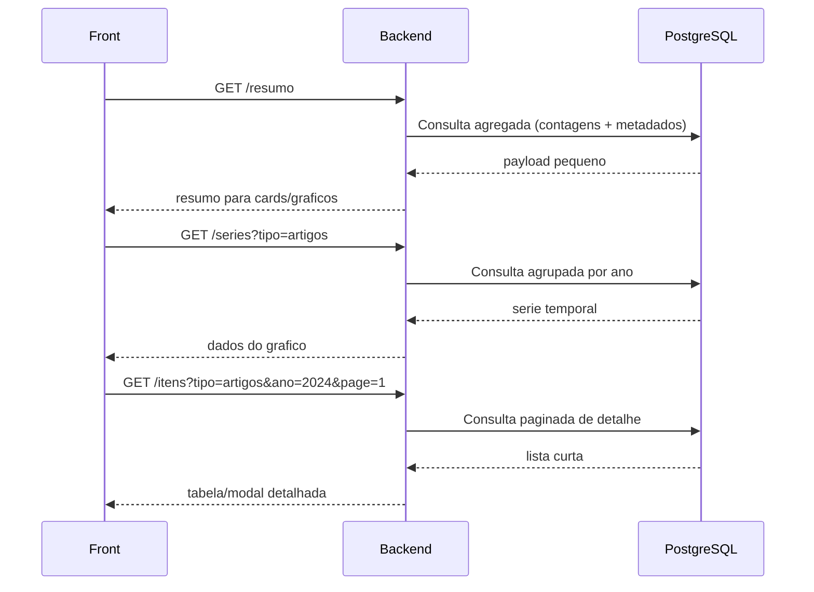
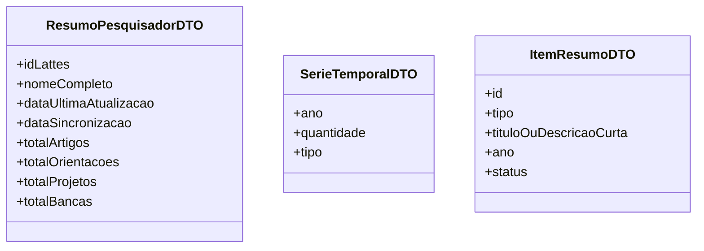

# LattesVision

## Visão Geral do Projeto
Plataforma web para **extração, visualização e análise automatizada de dados de Currículos Lattes** (CNPq).

**Autor:** Renan Alencar Soares  
**Instituição:** Universidade Federal do Ceará – Campus Quixadá  
**Curso:** Engenharia de Software  
**Orientador:** Prof. Dr. Emanuel Ferreira Coutinho  
**Tipo:** Trabalho de Conclusão de Curso (TCC) – 2026

## Problema que Resolve
Coordenadores de Programas de Pós-Graduação (PPGs) precisam transferir manualmente dados do Lattes para a Plataforma Sucupira (CAPES) a cada ciclo de avaliação quadrienal. Esse processo é lento, manual e sujeito a erros. O LattesVision automatiza a coleta, estruturação e visualização desses dados.

## Público-Alvo
- Coordenadores de cursos de pós-graduação
- Secretários acadêmicos
- Gestores de PPGs

## Objetivos do Sistema
1. Extrair dados automaticamente de currículos da Plataforma Lattes via Web Scraping
2. Classificar e organizar produções e métricas acadêmicas conforme indicadores da CAPES
3. Exibir dashboards interativos com indicadores de desempenho dos pesquisadores/programas

## Stack Tecnológica
- **Backend:** Java com Spring Boot
- **Banco de Dados:** PostgreSQL
- **Frontend:** Vue.js com Apache ECharts
- **Web Scraping:** Playwright + Jsoup
- **Fonte de dados:** Plataforma Lattes (CNPq) — currículos em XML/XSD e páginas HTML

## Domínio do Problema (conceitos importantes)
- **Plataforma Lattes:** Base de currículos acadêmicos do CNPq com +9 milhões de registros
- **Currículo Lattes:** Estruturado em XML/XSD com campos como: Identificação, Formação, Produção Bibliográfica, Orientações, Bancas, etc.
- **Plataforma Sucupira:** Sistema oficial da CAPES para avaliação dos PPGs — é para onde os dados do Lattes precisam ir
- **Avaliação Quadrienal CAPES:** Ciclo de 4 anos onde PPGs recebem notas de 1-7 (mínimo 3 para credenciamento)
- **Web Scraping:** Técnica de extração automatizada de dados de páginas web

## Status Atual do Projeto
- TCC em andamento (2026)
- Parte do código já existe
- Fundamentação teórica escrita (Lattes, Sucupira, Web Scraping)
- Metodologia, Resultados e Conclusão ainda a desenvolver

## Convenções e Boas Práticas
- Código em **inglês** (variáveis, métodos, classes)
- Comentários e documentação em **português** (por ser TCC acadêmico)
- Seguir padrões do Spring Boot (camadas: Controller → Service → Repository)
- Usar JPA/Hibernate para persistência com PostgreSQL
- Testes unitários são bem-vindos

## Estrutura Esperada do Projeto (Spring Boot padrão)
```
lattesvision/
├── src/main/java/br/ufc/lattesvision/
│   ├── controller/
│   ├── service/
│   ├── repository/
│   ├── model/
│   ├── dto/
│   └── scraper/
├── src/main/resources/
│   └── application.properties
└── pom.xml
```

## Notas Importantes
- O Lattes **não possui API oficial pública** — a extração depende de Web Scraping ou do arquivo XML exportável
- O formato XSD do Lattes é público: http://lattes.cnpq.br/web/plataforma-lattes/extracao-de-dados
- Respeitar limites de requisições ao Lattes para não ser bloqueado
- O sistema deve alinhar os dados extraídos aos **5 quesitos da avaliação CAPES**: Proposta do Programa, Corpo Docente, Corpo Discente, Produção Intelectual e Inserção Social
## Memoria Tecnica (Atualizado em 2026-04-27)

### Backend status atual
- Stack ativa: Spring Boot + Playwright + Jsoup + PostgreSQL.
- Fluxo implementado e funcional: resolver ID interno -> scraping -> parse -> persistencia.
- Build local validado com sucesso: `mvn test -q`.

### Regras de API ja aplicadas
- Validacao de ID Lattes no controller: aceitar apenas 16 digitos numericos.
- Sincronizacao individual agora e `POST /api/lattes/sincronizar/{id}` (antes era GET).
- Sincronizacao em lote permanece `POST /api/lattes/sincronizar-lote`.
- Erros de validacao retornam HTTP 400.

### Observabilidade
- `ScraperService` migrado de `System.out/err` para logs estruturados com `slf4j`.
- Eventos logados: inicio/fim de lote, processamento por ID, retries, erros e resumo de persistencia.

### Pontos prioritarios para a proxima sessao
1. Adicionar testes unitarios de parser com fixtures HTML reais do Lattes.
2. Padronizar respostas de erro da API (payload de erro com mensagem/codigo).
3. Revisar documentacao OpenAPI para refletir 100% os codigos de resposta.
4. Opcional: mover credenciais do banco para variaveis de ambiente.

## Decisoes de Arquitetura para Dashboard (2026-04-27)

### Objetivo
Para visualizacao de dados no front-end, evitar retornar payload completo por padrao.
Priorizar endpoints agregados e detalhe sob demanda.

### Estrategia
1. `resumo` para cards e visão geral.
2. `series` para graficos (agrupamento por ano/tipo).
3. `itens` paginado para tabelas e modais de detalhe.

### Fluxo proposto
```mermaid
flowchart TD
    A[Front-end Dashboard] --> B[GET /api/dashboard/pesquisadores/{id}/resumo]
    A --> C[GET /api/dashboard/pesquisadores/{id}/series?tipo=artigos|orientacoes|projetos|bancas]
    A --> D[GET /api/dashboard/pesquisadores/{id}/itens?tipo=artigos&ano=2024&page=1&size=20]

    B --> E[(PostgreSQL)]
    C --> E
    D --> E
```

### Sequencia de uso no front


### DTOs sugeridos (visao de contrato)


### Trade-offs
- Pro: payload menor, front mais rapido, melhor UX.
- Contra: mais endpoints e DTOs para manter.

## Alinhamento de Retorno de Dados para Bibliometria (2026-04-29)

### Decisao consolidada
- Evitar retorno do objeto completo de pesquisador por padrao para telas de dashboard.
- Priorizar payloads agregados por metrica/categoria/status.
- Manter retorno de itens individuais apenas em fluxo de drill-down (detalhe sob demanda).

### Motivacao
- A visualizacao geral e individual bibliometrica nao precisa carregar todas as entidades completas em toda requisicao.
- Reduzir tamanho de resposta melhora performance, tempo de carregamento e experiencia do usuario.
- Separar contratos de dashboard dos modelos JPA reduz acoplamento entre front-end e persistencia.

### Contratos de API priorizados
1. `GET /api/dashboard/pesquisadores/{id}/resumo`
- Contagens agregadas e metadados principais.
- Exemplo de metricas: `totalArtigos`, `totalOrientacoes`, `totalOrientacoesConcluidas`, `totalOrientacoesEmAndamento`, `totalProjetos`, `totalBancas`, `dataUltimaAtualizacao`, `dataSincronizacao`.

2. `GET /api/dashboard/pesquisadores/{id}/series?tipo=...`
- Series para graficos (ex.: por ano, por tipo, por status).
- Exemplo: artigos por ano; orientacoes por ano/status; projetos por tipo; bancas por tipo.

3. `GET /api/dashboard/pesquisadores/{id}/itens?filtros...&page=&size=`
- Listas paginadas para detalhe somente quando usuario solicitar.

### Diretriz de implementacao
- Primeiro implementar `resumo` para liberar valor rapido ao front.
- Em seguida implementar `series` para os graficos principais.
- Por ultimo implementar `itens` paginado para detalhamento.

### Nota sobre ScriptLattes
- Utilizar ScriptLattes como etapa de enriquecimento/classificacao no pipeline de sincronizacao (offline ou batch), nao como dependencia em tempo de resposta do dashboard.

## Arquitetura de Chamadas: Visao de Grupo e Individual (2026-04-29)

### Cenario funcional
- O sistema deve aceitar sincronizacao de um ou mais IDs Lattes.
- O usuario deve conseguir:
  - visualizar indicadores consolidados de um grupo de pesquisadores/professores;
  - abrir o detalhe individual ao selecionar um pesquisador especifico.

### Separacao de responsabilidades
- Sincronizacao: endpoints de ingestao/coleta e persistencia.
- Consulta de dashboard: endpoints de leitura agregada (sem scraping em tempo real).

### Endpoints de sincronizacao
1. `POST /api/lattes/sincronizar/{id}`
2. `POST /api/lattes/sincronizar-lote`

### Estrategia para grupos persistidos
- Criar conceito de grupo para reuso e analise recorrente.
- Endpoint sugerido para cadastro:
  - `POST /api/grupos`
  - Exemplo de payload: `{ "nome": "Docentes PPG ES", "idsLattes": ["..."] }`
  - Retorno esperado: `grupoId`.

### Endpoints de dashboard: visao de grupo
1. `GET /api/dashboard/grupos/{grupoId}/resumo`
- Cards consolidados do grupo.
- Ex.: `totalPesquisadores`, `totalArtigos`, `totalOrientacoesConcluidas`, `totalProjetos`, `totalBancas`.
- Incluir metricas derivadas, quando aplicavel: `mediaArtigosPorPesquisador`, `percentualOrientacoesConcluidas`.

2. `GET /api/dashboard/grupos/{grupoId}/series?tipo=...&agruparPor=...`
- Series agregadas para graficos (somatorio dos membros).

3. `GET /api/dashboard/grupos/{grupoId}/ranking?metrica=...&ordem=desc&page=0&size=20`
- Ranking paginado por metrica (artigos, orientacoes, etc.).

4. `GET /api/dashboard/grupos/{grupoId}/itens?tipo=...&filtros...&page=0&size=20`
- Drill-down paginado de itens do grupo.

### Endpoints de dashboard: visao individual
1. `GET /api/dashboard/pesquisadores/{id}/resumo`
2. `GET /api/dashboard/pesquisadores/{id}/series?tipo=...&agruparPor=...`
3. `GET /api/dashboard/pesquisadores/{id}/itens?tipo=...&filtros...&page=0&size=20`

### Padronizacao de contrato
- Padronizar estrutura de resposta entre escopos (`GROUP` e `RESEARCHER`) para simplificar front-end.
- Exemplo conceitual: `scope`, `refId`, `cards`, `filtrosAplicados`, `dados`.

### Filtros transversais recomendados
- `periodoInicio`, `periodoFim`, `tipo`, `status`, `ano`.

### Regras nao funcionais recomendadas
- Nunca retornar entidade JPA completa nos endpoints de dashboard.
- Usar DTOs agregados e DTOs de detalhe paginado.
- Paginacao obrigatoria em `ranking` e `itens`.
- Aplicar cache curto nos GETs de dashboard (30-120s).

### Opcao de grupo ad-hoc (sem persistencia)
- Endpoint opcional para analise pontual por lista de IDs:
  - `POST /api/dashboard/grupo-adhoc/resumo`
- Observacao: para uso recorrente, preferir grupos persistidos (`grupoId`) por rastreabilidade e desempenho.

## Proxima Feature Planejada: Producao Tecnica (2026-04-29)

### Contexto da decisao
- Foi validado no repositorio `scriptLattes-main/` que a producao tecnica e tratada de forma explicita em categorias separadas.
- Objetivo no LattesVision: incorporar esse bloco ao backend para ampliar cobertura bibliometrica/CAPES alem de artigos, orientacoes, projetos e bancas.

### Evidencias no scriptLattes (referencia funcional)
Categorias identificadas no `scriptLattes-main/scriptLattes/producoesTecnicas/`:
- `softwareComPatente.py` (programa de computador com registro)
- `softwareSemPatente.py` (programa de computador sem registro)
- `produtoTecnologico.py`
- `processoOuTecnica.py`
- `trabalhoTecnico.py`
- `outroTipoDeProducaoTecnica.py`
- `entrevista.py`

Complementarmente, o `README.md` do scriptLattes destaca producao tecnica e exportacao JSON individual abrangente.

### Diretriz de modelagem recomendada no backend (fase inicial)
- Criar entidade unica `ProducaoTecnica` relacionada a `Pesquisador`.
- Adotar `categoria` (enum) para representar os tipos tecnicos sem fragmentar em varias tabelas no primeiro momento.

Categorias iniciais sugeridas:
- `SOFTWARE_COM_REGISTRO`
- `SOFTWARE_SEM_REGISTRO`
- `PRODUTO_TECNOLOGICO`
- `PROCESSO_OU_TECNICA`
- `TRABALHO_TECNICO`
- `OUTRA`

Campos minimos sugeridos para MVP:
- `id`
- `categoria`
- `titulo`
- `autoresTexto`
- `ano`
- `natureza` (quando aplicavel, ex.: processo/tecnica)
- `descricaoBruta` (texto original extraido para rastreabilidade)
- `pesquisador` (ManyToOne)

### Metricas iniciais (entrega de valor rapida)
1. Total de producoes tecnicas por pesquisador.
2. Total por categoria tecnica.
3. Serie temporal por ano (producao tecnica).
4. Ranking por pesquisador em contexto de grupo (quantidade de producao tecnica).

### Estrategia de implementacao sugerida (proxima sessao)
1. Model + migration (`ProducaoTecnica` + enum categoria).
2. Parser de producao tecnica no scraping atual.
3. Persistencia vinculada ao `Pesquisador`.
4. Inclusao no endpoint `resumo` (individual e grupo).
5. Inclusao no endpoint `series` por categoria/ano.
6. Opcional: endpoint `itens` paginado para drill-down de producao tecnica.

### Trade-off assumido
- Opcao por entidade unica com enum acelera entrega e simplifica consultas de dashboard.
- Caso a complexidade cresca (muitos campos especificos por categoria), evoluir para subtipos/tabelas especializadas em fase posterior.

## Memoria Tecnica (Atualizado em 2026-05-06)

### Testes unitarios de parsers
- Foram adicionados testes unitarios puros para os parsers atuais, sem subir Spring nem banco:
  - `ArtigoParserTest`
  - `OrientacaoParserTest`
  - `ProjetoParserTest`
  - `BancaParserTest`
  - `ProducaoTecnicaParserTest`
- Objetivo: fixar comportamento de extracao a partir de HTML minimo representativo do Lattes.
- Ajustes feitos durante os testes:
  - `OrientacaoParser` passou a normalizar texto para busca, reduzindo fragilidade com acentos/sem acentos.
  - `BancaParser` tambem passou a normalizar texto para busca e marcador de "Participacao em banca de".
- Validacao local: `mvn test -q` executado com sucesso.

### Producao Tecnica implementada no backend
- Feature implementada no escopo enxuto decidido para o LattesVision.
- Nao foi replicado o detalhamento completo do `scriptLattes`; a decisao foi manter uma visao geral adequada para dashboard/bibliometria.
- Nova modelagem:
  - `CategoriaProducaoTecnica`
  - `ProducaoTecnica`
- Categorias adotadas:
  - `SOFTWARE_COM_REGISTRO`
  - `SOFTWARE_SEM_REGISTRO`
  - `PRODUTO_TECNOLOGICO`
  - `PROCESSO_OU_TECNICA`
  - `TRABALHO_TECNICO`
  - `OUTRA`
- Entrevistas, mesas redondas, programas e comentarios na midia sao mapeados para `OUTRA`, por serem considerados menos relevantes para o foco atual do dashboard.
- Campos persistidos em `ProducaoTecnica`:
  - `id`
  - `categoria`
  - `titulo`
  - `autoresTexto`
  - `ano`
  - `natureza`
  - `descricaoBruta`
  - `pesquisador`
- `descricaoBruta` foi mantida para rastreabilidade e eventual reprocessamento futuro.
- `Pesquisador` agora possui relacionamento `OneToMany` com `producoesTecnicas`, usando cascade e orphan removal como nas demais colecoes.
- `ScraperService` passou a chamar `ProducaoTecnicaParser.parse(doc)` e persistir a colecao junto com artigos, orientacoes, projetos e bancas.

### Referencia usada do scriptLattes
- Codigo consultado em `scriptLattes-main/`.
- O scriptLattes separa producao tecnica em varias classes:
  - `softwareComPatente.py`
  - `softwareSemPatente.py`
  - `produtoTecnologico.py`
  - `processoOuTecnica.py`
  - `trabalhoTecnico.py`
  - `outroTipoDeProducaoTecnica.py`
  - `entrevista.py`
- Conclusao da analise:
  - A regra de extracao e muito parecida entre categorias.
  - Para o LattesVision, entidade unica com enum e suficiente neste momento.
  - Campos especificos como finalidade, instituicao, veiculo etc. ficaram fora do MVP.

### Validacao manual via Swagger
- Endpoint usado:
  - `POST /api/lattes/sincronizar/{id}`
- Como `spring.jpa.hibernate.ddl-auto=update` esta ativo, a tabela `producoes_tecnicas` foi criada/atualizada automaticamente pelo Hibernate.
- Teste 1 retornou producoes tecnicas em `SOFTWARE_SEM_REGISTRO`, extraindo corretamente:
  - autores
  - titulo
  - ano
  - descricao bruta
- Teste 2 retornou uma lista maior com:
  - `SOFTWARE_SEM_REGISTRO`
  - `TRABALHO_TECNICO`
- Caso validado: titulo contendo referencia como `2015.2` e ano final `2016`; parser capturou corretamente o ultimo ano como ano da producao.

### Pontos pendentes / proximos passos
1. Criar endpoints de dashboard agregados para pesquisador:
   - `GET /api/dashboard/pesquisadores/{id}/resumo`
   - incluir `totalProducoesTecnicas`.
2. Criar series de producao tecnica:
   - por ano
   - por categoria
3. Criar itens paginados para drill-down:
   - filtro por `tipo=producoesTecnicas`
   - filtro por categoria e ano.
4. Avaliar se o endpoint bruto `GET /api/lattes/{id}` deve continuar retornando entidade completa ou se deve ser tratado como endpoint administrativo/debug.
5. Opcional: adicionar repository especifico para `ProducaoTecnica` quando forem implementadas consultas agregadas.
6. Opcional: mover credenciais do banco para variaveis de ambiente.

## Memoria Tecnica (Atualizado em 2026-05-10)

### Dashboard individual - resumo agregado e series temporais
- Foi consolidado o modulo de dashboard com foco em indicadores bibliometricos.
- Endpoint de resumo individual: `GET /api/dashboard/pesquisadores/{id}/resumo` (validado).
  - Campos: `idLattes`, `nomeCompleto`, `dataUltimaAtualizacao`, `dataSincronizacao`, `totalArtigos`, `totalOrientacoes`, `totalOrientacoesConcluidas`, `totalOrientacoesEmAndamento`, `totalProjetos`, `totalBancas`, `totalProducoesTecnicas` e `totalTrabalhosEventos`.
- Novo endpoint de series temporais: `GET /api/dashboard/pesquisadores/{id}/series?tipo=...`
  - Suporta: `artigos`, `orientacoes`, `projetos`, `bancas`, `producoes_tecnicas` e `trabalhos_eventos`.
  - Retorna dados agrupados por ano e ordenados cronologicamente.

### Implementacao de Trabalhos em Eventos
- Nova entidade `TrabalhoEvento` vinculada ao `Pesquisador`.
- Parser especializado `TrabalhoEventoParser`:
  - Focado exclusivamente em **Trabalhos completos publicados em anais de congressos**.
  - Ignora resumos simples e expandidos para alinhar a contagem com o resumo oficial do Lattes.
  - Implementada "trava de segurança" para interromper a captura ao encontrar seções não relacionadas (evita vazamento de dados de bancas/orientações).
- Validacao real: Contagem de 81 trabalhos completos para o pesquisador de teste batendo 100% com o portal Lattes.

### Referencias e Inspiracao
- Analise do `scriptLattes-main` (Python) concluida.
- Decisao arquitetural: Manter a estrutura de dados rica no banco (com tipos e categorias), mas expor endpoints agregados para o frontend manter alta performance.

### Pontos pendentes / proximos passos
1. Implementar dashboard de **Grupos** (visao consolidada de varios pesquisadores).
2. Criar endpoint de **Itens Paginados** para drill-down (detalhe por ano/tipo).
3. Evoluir para indicadores de producao bibliografica de Livros e Capitulos.

## Memoria Tecnica (Atualizado em 2026-06-25)

### Frontend iniciado com Vue 3 + Vite + TypeScript
- Foi criado o projeto `frontend/` com Vue 3, Vite e TypeScript.
- Dependencias adicionadas:
  - `vue-router`
  - `pinia`
  - `axios`
  - `echarts`
- Estrutura inicial implementada:
  - `src/router`
  - `src/views`
  - `src/components/dashboard`
  - `src/services`
  - `src/stores`
  - `src/types`

### Base funcional inicial do frontend
- O template padrao do Vite foi removido e substituido por uma base de aplicacao real.
- Foram criadas:
  - tela inicial para entrada do ID Lattes;
  - tela de dashboard individual;
  - store Pinia para resumo e series temporais;
  - cliente HTTP com `axios`;
  - componente de grafico com `ECharts`.
- O `vite.config.ts` foi configurado com proxy:
  - `/api -> http://localhost:8080`

### Ajuste de regra de negocio para consulta do dashboard
- Foi identificado um problema de UX no fluxo inicial:
  - o frontend chamava `GET /api/dashboard/pesquisadores/{id}/resumo`;
  - se o pesquisador nao existisse localmente, o backend retornava `404`;
  - isso exigia que o usuario soubesse previamente se o ID ja estava sincronizado.
- Decisao tomada:
  - a regra de "consultar se existir, sincronizar se nao existir" deve ficar no backend, nao no frontend.

### Novo endpoint de entrada unico para dashboard individual
- Foi criado o endpoint:
  - `POST /api/dashboard/pesquisadores/{id}/carregar`
- Regra implementada:
  - se o pesquisador ja existe no banco, retornar o resumo agregado imediatamente;
  - se nao existe, executar `ScraperService.sincronizarPesquisador(id)` e depois retornar o resumo agregado.
- Implementacao realizada em:
  - `DashboardController`
  - `DashboardService`
- `DashboardService` passou a depender de `ScraperService` para executar o fallback de sincronizacao quando necessario.

### Testes adicionados no backend
- Foi criado teste unitario para travar o comportamento do novo fluxo:
  - `DashboardServiceTest`
- Casos cobertos:
  - nao sincronizar quando o pesquisador ja existe localmente;
  - sincronizar quando o pesquisador nao existe no banco.
- Validacao executada com sucesso:
  - `mvn test -q`

### Integracao do frontend com o novo endpoint
- O frontend foi alterado para usar `POST /api/dashboard/pesquisadores/{id}/carregar` como porta de entrada do dashboard individual.
- Fluxo atual do frontend:
  1. usuario informa o ID Lattes;
  2. frontend chama `POST /carregar`;
  3. backend decide entre retornar do banco ou sincronizar;
  4. frontend recebe o resumo;
  5. frontend chama `GET /api/dashboard/pesquisadores/{id}/series?tipo=...`.

### Observacoes importantes para a proxima sessao
- A interface atual do frontend foi criada como base funcional para integracao com backend.
- O proprio usuario sinalizou que a direcao visual atual esta com "cara de IA" e deve ser redesenhada depois.
- Portanto, o estado atual do frontend deve ser tratado como:
  - base tecnica valida;
  - nao como direcao visual final do produto.

### Proximos passos recomendados
1. Redesenhar a linguagem visual do frontend com uma direcao menos generica e mais autoral.
2. Melhorar feedback de carregamento no dashboard para deixar explicito quando o backend esta sincronizando um pesquisador novo.
3. Evoluir para dashboard de grupos, ranking e drill-down paginado quando a camada de leitura agregada crescer.

## Memoria Tecnica (Atualizado em 2026-07-01)

### Redesenho visual do frontend
- A tela inicial foi redesenhada para uma estetica mais institucional/sistema academico, evitando visual generico de IA.
- Diretrizes aplicadas:
  - fundo simples e claro;
  - menos cards decorativos;
  - bordas discretas;
  - tipografia global inspirada na Microsoft:
    - `"Segoe UI", SegoeUI, "Helvetica Neue", Helvetica, Arial, sans-serif`;
  - paleta principal baseada em azul institucional.
- A logo do LattesVision foi adicionada no header a partir de:
  - `frontend/src/assets/Lattes_VISION__1_-removebg-preview.png`
- Header atual:
  - logo a esquerda;
  - links `Inicio` e `Sobre` a direita, ainda sem navegacao real.
- A home passou a usar o titulo:
  - `Analise de Curriculos Lattes`
- O botao principal passou a ser:
  - `Analisar`
- O campo de entrada foi alterado para:
  - `ID(s) Lattes`

### Feedback de carregamento antes do dashboard
- Foi implementado modal de espera na home antes de redirecionar para o dashboard.
- Fluxo individual atual:
  1. usuario informa um ID Lattes;
  2. clica em `Analisar`;
  3. a home exibe modal `Consultando curriculo`;
  4. o frontend chama `POST /api/dashboard/pesquisadores/{id}/carregar`;
  5. somente apos receber o resumo, redireciona para `/pesquisadores/{id}`.
- A store Pinia passou a registrar `currentResumoId`, evitando reaproveitar dados de pesquisador antigo quando a rota muda.
- `loadResumo` limpa resumo e serie antigos antes de iniciar nova consulta.

### Entrada com multiplos IDs Lattes
- A home agora aceita:
  - um unico ID Lattes;
  - multiplos IDs separados por virgula, espaco, ponto e virgula ou quebra de linha.
- Validacao no frontend:
  - cada ID deve possuir exatamente 16 digitos numericos.
- Fluxo:
  - 1 ID: usa dashboard individual;
  - 2+ IDs: usa dashboard de grupo ad-hoc.

### Dashboard de grupo ad-hoc implementado
- Foi criado suporte real a analise de grupo, sem persistir um cadastro de grupo ainda.
- Novo endpoint backend:
  - `POST /api/dashboard/grupo-adhoc/carregar`
- Payload:
```json
{
  "idsLattes": ["9359546788802277", "6255476538629622"]
}
```
- Regra de negocio:
  - para cada ID informado:
    - se pesquisador ja existe no banco, usa o registro local;
    - se nao existe, executa `ScraperService.sincronizarPesquisador(id)`;
  - depois monta resumo agregado do grupo.
- Isso evita scraper desnecessario para curriculos ja salvos e reduz risco de bloqueio no Lattes.
- DTOs adicionados:
  - `GrupoAdhocRequestDTO`
  - `ResumoGrupoDTO`
- Metodo principal no service:
  - `DashboardService.carregarResumoGrupoAdhoc(List<String> idsLattes)`
- Teste unitario adicionado em `DashboardServiceTest` para garantir que pesquisadores ja existentes nao sao sincronizados novamente.

### Tela de dashboard de grupo no frontend
- Nova rota:
  - `/grupos/adhoc?ids=...`
- Nova view:
  - `frontend/src/views/GrupoAdhocView.vue`
- A tela exibe:
  - titulo `Analise de grupo`;
  - quantidade de curriculos analisados;
  - botao `Exportar Dados` sem acao por enquanto;
  - cards agregados:
    - pesquisadores;
    - artigos;
    - orientacoes;
    - projetos;
    - bancas;
    - producoes tecnicas;
    - trabalhos em eventos;
  - bloco de filtros em preparacao;
  - lista de pesquisadores analisados com acao `Ver individual`.
- A store `dashboard.ts` passou a manter:
  - `resumoGrupo`;
  - `grupoIds`;
  - `serieGrupo`.

### Grafico de evolucao anual do grupo
- Foi criado endpoint backend para series anuais agregadas:
  - `POST /api/dashboard/grupo-adhoc/series`
- DTO adicionado:
  - `SerieGrupoDTO`
- O endpoint agrega por ano os tipos ja existentes no backend:
  - artigos;
  - trabalhos em eventos;
  - producoes tecnicas;
  - orientacoes;
  - projetos;
  - bancas.
- No frontend foi criado:
  - `frontend/src/components/dashboard/GrupoStackedLineChart.vue`
- O grafico usa Apache ECharts e aparece abaixo dos filtros na tela de grupo.
- Titulo da secao:
  - `Producao por ano`
- Subtitulo:
  - `Evolucao anual das producoes academicas por tipo.`
- O grafico foi ajustado para linhas sem preenchimento/area, pois o preenchimento estava visualmente estranho.
- Observacao importante:
  - livros e capitulos ainda nao existem no backend; quando forem implementados, devem entrar no `SerieGrupoDTO`, no agregador do `DashboardService` e no grafico.

### Ajustes no dashboard individual
- O topo do dashboard individual foi simplificado:
  - removeu o bloco `Serie exibida`;
  - removeu texto generico sobre backend;
  - manteve apenas `ID Lattes {id}`.
- Adicionado botao `Exportar Dados`, ainda sem acao.
- Foi reservado bloco de filtros abaixo dos cards de resumo:
  - periodo inicial;
  - periodo final;
  - botao `Aplicar filtros` desativado.
- A fonte do ECharts foi padronizada explicitamente para a mesma stack global do projeto, pois canvas nao herda CSS de forma confiavel.

### Validacoes executadas
- Backend:
  - `mvn test -q` executado com sucesso.
- Frontend:
  - `npm run build` executado com sucesso.
- Avisos conhecidos:
  - Vite alerta bundle grande por causa do ECharts;
  - Maven/Mockito alerta sobre ByteBuddy agent dinamico, mas os testes passam.

### Proximos passos recomendados
1. Criar endpoint de itens paginados para drill-down.
   - individual e grupo;
   - por ano/tipo/categoria;
   - objetivo: permitir auditar quais itens compoem os totais e graficos.
2. Implementar filtros reais no backend e frontend.
   - `periodoInicio`
   - `periodoFim`
   - tipo de producao
   - pesquisador
3. Evoluir producao bibliografica com livros e capitulos.
   - modelagem;
   - parser;
   - persistencia;
   - inclusao nos resumos e series.
4. Avaliar persistencia de grupos nomeados.
   - `POST /api/grupos`
   - reuso posterior por `grupoId`.
5. Refinar visual dos dashboards.
   - hierarquia de graficos;
   - densidade dos cards;
   - estado vazio;
   - responsividade.

## Memoria Tecnica (Atualizado em 2026-07-02)

### Ranking de pesquisadores no dashboard de grupo
- Foi implementado o ranking por pesquisador na tela de grupo ad-hoc.
- Novo endpoint backend:
  - `POST /api/dashboard/grupo-adhoc/ranking?metrica=...`
- Payload:
```json
{
  "idsLattes": ["9359546788802277", "6255476538629622"]
}
```
- Metricas suportadas:
  - `total`
  - `artigos`
  - `orientacoes`
  - `projetos`
  - `bancas`
  - `producoes_tecnicas`
  - `trabalhos_eventos`
- Novo DTO:
  - `RankingPesquisadorDTO`
- Regra do backend:
  - reaproveita o mesmo fluxo de grupo ad-hoc;
  - usa pesquisador local quando ja existe;
  - sincroniza apenas IDs ausentes;
  - calcula a quantidade por pesquisador;
  - ordena de forma decrescente pela quantidade.
- Teste unitario adicionado em `DashboardServiceTest` para validar ordenacao do ranking por metrica.

### Ranking no frontend
- Novo componente:
  - `frontend/src/components/dashboard/GrupoRankingChart.vue`
- O grafico usa Apache ECharts com barras horizontais, mais adequado para nomes longos de pesquisadores.
- A tela `GrupoAdhocView.vue` recebeu a secao:
  - `Ranking de pesquisadores`
- Foi adicionado seletor de metrica no painel:
  - Total geral
  - Artigos
  - Trabalhos em eventos
  - Producoes tecnicas
  - Orientacoes
  - Projetos
  - Bancas
- A store `dashboard.ts` passou a manter:
  - `rankingGrupo`
  - `rankingMetrica`
  - `loadingRanking`
  - `errorRanking`
- O service `dashboard.service.ts` recebeu a chamada:
  - `fetchRankingGrupoAdhoc(idsLattes, metrica)`

### Ajuste de suavidade nos graficos
- Foi identificado que o ranking "piscava" ao trocar metrica porque a store limpava `rankingGrupo` antes da nova resposta.
- Ajuste aplicado:
  - manter o grafico antigo enquanto a nova metrica carrega;
  - atualizar os dados somente quando a resposta chega;
  - mostrar loading apenas na carga inicial, quando ainda nao ha dados.
- O mesmo padrao foi aplicado tambem:
  - no grafico de series temporais do dashboard individual;
  - no grafico de evolucao anual do grupo.
- Resultado: trocas de metrica/tipo ficam mais suaves, sem desmontar e remontar o grafico quando ja existe dado em tela.

### Validacoes executadas
- Backend:
  - `.\mvnw.cmd test -q` executado com sucesso em `backend/`.
- Frontend:
  - `npm run build` executado com sucesso em `frontend/`.
- Observacoes:
  - `mvn test -q` usando Maven global apresentou problema de `testCompile` nao enxergando classes principais;
  - o wrapper `.\mvnw.cmd test -q` funciona corretamente e deve ser preferido neste projeto;
  - Vite segue alertando bundle grande por causa do ECharts, mas o build passa.

### Proximo passo recomendado
- Priorizar drill-down paginado antes de novos graficos.
- Motivacao:
  - os dashboards ja mostram totais, evolucao anual e ranking;
  - falta permitir ao usuario auditar quais itens compoem cada numero.
- Contrato sugerido:
  - endpoint de itens paginados para individual e grupo;
  - filtros por tipo, ano, categoria e pesquisador;
  - tabela no frontend para listar titulo/descricao, pesquisador, ano e status/categoria quando aplicavel.
